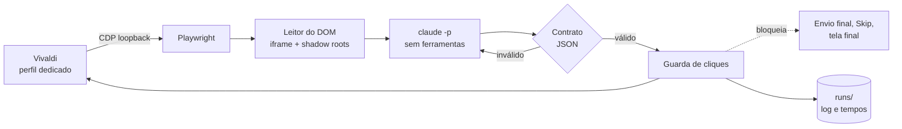

<div align="center">

# DRACAENA

Automação de interface via Chrome DevTools Protocol, com leitura estruturada do DOM, contrato de resposta validado e uma guarda única de ações.

</div>

> [!NOTE]
> Este é um projeto **pessoal**, validado apenas em Arch Linux com Hyprland e Vivaldi. O nome dos comandos continua
> sendo `quiz-*`, herdado do nome original do projeto (`quiz-helper`). Leia a seção
> [Uso responsável](#uso-responsável) antes de usar.

O DRACAENA é uma ferramenta em Python que se conecta, por Chrome DevTools Protocol, a um navegador já aberto, lê o
estado de uma página como dados estruturados (iframe e shadow roots abertos), entrega o enunciado ao Claude Code em modo
não interativo e aplica a resposta por uma guarda que concentra todas as ações. A resposta volta como JSON e só chega à
página depois de passar por um contrato que valida índices, quantidade e formato. A ferramenta foi testada em atividades
do NetAcad, que é só o ambiente de teste: nada na arquitetura depende dele além do módulo que conhece a estrutura da página.

Não há OCR, captura de tela para leitura nem automação de mouse. Como as ações saem pelo CDP e não movem o cursor, o
computador continua utilizável enquanto o loop roda.

## Funcionalidades

| | O que faz |
|---|---|
| **Leitura pelo DOM** | Percorre o iframe `authoring-resources` e os shadow roots abertos. Reconhece `mcq-view` (resposta única e múltipla), `matching-view` / `matching-dropdown-view` (listas de seleção) e `object-matching-view` (associação). |
| **Contrato de resposta** | O Claude responde em JSON de quatro tipos: `SINGLE`, `MULTI`, `DROPDOWN` e `MATCH`. Índices fora do intervalo, quantidade errada ou resposta mal formada derivam para uma segunda tentativa, nunca para um clique. |
| **Guarda de cliques** | Um único ponto aplica toda ação. Bloqueia o envio final, a confirmação de envio, Skip All, Skip Question e a tela final, e confere o alvo antes de agir. |
| **Loop com pausa** | `SUPER+P` inicia, pausa e retoma. Qualquer situação inesperada (atividade nova, figura ausente, marcação não confirmada) pausa e notifica, em vez de insistir. |
| **Segunda tentativa** | Nas seções do curso, que mostram feedback de acerto, a ferramenta reconsulta o Claude com o feedback, usa Reset e responde de novo. |
| **Dry-run** | `--dry-run` lê, consulta o Claude e simula os cliques sem tocar na página. |
| **Cronometragem** | Cada questão registra o tempo de leitura do DOM, do Claude, das ações, do Submit, da espera de avanço e do restante. `python -m quizhelper timings` resume tudo (rode com o Python do venv e `PYTHONPATH=lib`). |
| **Diagnóstico** | `quiz-doctor` confere venv, Playwright, Claude, prompts, symlinks, perfil, porta, endpoint CDP, aba, iframe e a leitura de uma questão, sem clicar e sem gastar cota. |
| **Privacidade** | Execuções em pastas `700` e arquivos `600`, credenciais reportadas só como `definida` ou `ausente`, CDP somente em loopback. |

## Por que o nome?

*Dracaena* é um gênero de plantas, e o seu membro mais famoso nas casas brasileiras é a espada de São Jorge, *Dracaena trifasciata*, que até poucos anos atrás se chamava *Sansevieria trifasciata*. Estudos genéticos mostraram que as sansevierias eram uma linhagem suculenta dentro das dracenas, e a nomenclatura foi unificada. O nome científico vem do grego *drákaina*, "dragoa"; o popular, das folhas longas, eretas e pontiagudas, que lembram uma espada ou uma lança.

O santo é Jorge, soldado romano de origem na Capadócia, martirizado por volta do ano 303, na perseguição de Diocleciano, e venerado como mártir desde a Antiguidade. A parte do dragão é **lenda**, posterior ao martírio e popularizada na Idade Média: uma cidade entregava vítimas ao monstro, a princesa era a próxima, e Jorge o enfrenta com uma lança. A devoção chegou ao Brasil com os portugueses, o dia do santo é 23 de abril e, no sincretismo religioso brasileiro, ele é associado a Ogum. Aqui ele entra só como imagem, com respeito.

A imagem serve ao projeto. O dragão é a questão que parece grande demais; a lança é a ação precisa. A ferramenta lê a página sem ruído, decide pouco e age com exatidão, por uma guarda que só deixa passar o clique permitido. É só uma metáfora, mas combina.

Quanto ao comando, ele continua `quiz-*` por herança do `quiz-helper`. Renomear tudo era trabalho demais para um dragão tão pequeno.

## Como foi feito

O DRACAENA foi desenvolvido por um processo assistido por agentes de IA, com papéis separados e uma única pessoa decidindo
o que entra. A separação existe por um motivo prático: quem lê logs e formula hipóteses não deve ser quem escreve o código
e quem escreve o código não deve ser quem o aprova.

| Papel | Quem | Responsabilidade |
|---|---|---|
| **Operador** | Pedro | Define o objetivo, executa a ferramenta num ambiente real, fornece logs e capturas e decide cada merge. |
| **Analista e arquiteto** | Claude (conversa) | Inventaria o repositório, lê os registros de execução, formula e descarta hipóteses e redige a especificação de cada tarefa, com escopo e critérios de aceitação. |
| **Executor** | Codex | Recebe uma especificação fechada, trabalha numa branch, faz um commit por item, roda a suíte e devolve um relatório. Não faz push. |
| **Motor de resposta** | Claude Code | Roda dentro do produto: cada consulta é uma chamada `claude -p` isolada (ver [Motor de resposta isolado](#5-motor-de-resposta-isolado)). |

O Claude Code aparece em dois lugares de propósito: fora do produto, ajudando a projetar e diagnosticar; dentro dele, como
componente restrito e sem memória entre consultas.

### Ciclo de trabalho

Cada tarefa seguiu o mesmo ciclo de cinco passos:

1. **Observação.** O operador roda a ferramenta num ambiente real e entrega o que viu: log, `questions.jsonl` e capturas.
2. **Diagnóstico.** O analista lê `run.log`, `questions.jsonl` e as saídas cruas do Claude, isola a causa e confirma no código.
3. **Especificação.** O analista escreve a tarefa com escopo, arquivos permitidos, testes exigidos e o que não pode mudar.
4. **Execução.** O executor entrega uma branch com um commit por item e um relatório do que fez e do que não conseguiu fazer.
5. **Aceitação.** O operador confere o relatório, roda a suíte, faz o merge e repete a execução real que originou a tarefa.

O critério de aceitação de cada tarefa tem duas partes: a suíte offline passa (incluindo um teste novo que reproduz o
defeito) e a situação real que o originou deixa de ocorrer. Sem as duas, a tarefa volta ao passo 2. Esse ciclo produziu,
entre outras mudanças, a remoção do motor legado de OCR, as três correções abaixo e a deduplicação dos instaladores.

### Defeitos encontrados em execução real

Os três defeitos abaixo só apareceram com a ferramenta rodando contra a página de verdade. Cada um virou teste.

<details>
<summary><b>1. Dropdown com ordem de opções diferente de <code>data-index</code></b></summary>

- **Sintoma.** O loop pausava com "dropdown não mostra a opção escolhida", embora a opção certa tivesse sido clicada.
- **Causa raiz.** Na página, os `<li role=option>` de um dropdown podem vir numa ordem do DOM diferente do atributo
  `data-index`. A extração em `lib/quizhelper/dom.py` guardava as opções na ordem do DOM, mas o clique usa `data-index` e
  o contrato fala em índice. A conferência em `lib/quizhelper/actions.py` indexava a lista por posição (`options[o]`) e
  olhava, portanto, a opção errada.
- **Correção.** A extração ordena as opções por `data-index`, e a conferência passa a aceitar também o texto exibido no
  botão do dropdown (`shown`), que não depende de `aria-selected` estar atualizado. Commit `6621504`.
- **Teste.** `tests/py/test_dropdown.py`, com uma fixture em que a ordem do DOM é invertida: confere a ordenação, a seleção
  sem pausa e o caso em que só o texto exibido confirma a escolha.

</details>

<details>
<summary><b>2. Dry-run que acusava erro por esperar a confirmação de um clique inexistente</b></summary>

- **Sintoma.** Em `--dry-run`, a simulação terminava com a pausa "marcação não confirmada".
- **Causa raiz.** No modo de simulação a guarda não clica, mas o executor de ações ainda esperava que o DOM refletisse o
  clique, e a conferência nunca podia passar.
- **Correção.** Em `lib/quizhelper/actions.py`, a conferência é dada como satisfeita quando a guarda está em simulação.
  Commit `f4eaa2e`.
- **Teste.** `tests/py/test_dry_run.py` aplica uma resposta de cada tipo com a guarda em simulação e verifica que nenhum
  clique aconteceu, que a página ficou intacta, que nenhuma espera foi feita e que o log tem uma linha por ação simulada.

</details>

<details>
<summary><b>3. Diagnóstico que não reconhecia a flag do perfil</b></summary>

- **Sintoma.** `quiz-doctor` reportava "navegador com perfil dedicado e porta configurada" como falha, com o navegador
  aberto corretamente pelo `quiz-browser`.
- **Causa raiz.** O diagnóstico lê `/proc/<pid>/cmdline` e comparava cada argumento separado por NUL. O Vivaldi reescreve a
  linha de comando do processo principal como um texto único separado por espaços, então a comparação nunca encontrava
  as flags.
- **Correção.** `cmdline_matches`, em `lib/quizhelper/doctor.py`, aceita as duas formas, exige a flag com limites de
  argumento (para `--remote-debugging-port=92220` não casar com 9222) e ignora processos auxiliares com `--type=`.
  Commit `339bd43`. No formato de texto único, espaços em caminhos são ambíguos; o código registra essa limitação.
- **Teste.** `CmdlineMatchesTest`, em `tests/py/test_doctor.py`: argumentos separados por NUL e por espaço, porta e perfil
  diferentes, prefixo de valor, processo auxiliar e caracteres especiais no caminho.

</details>

## Instalar

Requisitos: Python 3.10+ com `venv`, Bash, `curl`, `ss`, `flock` e `setsid`, Vivaldi (`vivaldi-stable`) e o Claude Code
instalado e autenticado (`claude auth login`). São opcionais `notify-send`, `wl-copy` e o Hyprland para os atalhos.

```sh
git clone https://github.com/Pedrojscx/dracaena.git ~/src/dracaena
cd ~/src/dracaena
./install.sh --check     # só verifica as dependências
./install.sh             # venv privado, quatro symlinks e configuração inicial
```

O instalador é idempotente: não usa `sudo`, não instala pacotes do sistema, não baixa navegador, não sobrescreve a
configuração pessoal e não edita o Hyprland. Ele grava em `~/.config/quiz-helper/paths` o caminho do `claude`, porque
os atalhos do Hyprland não herdam o `PATH` do terminal. Para remover tudo: `./uninstall.sh`.

## Uso

```sh
quiz-browser        # abre o Vivaldi com perfil dedicado e CDP em 127.0.0.1:9222
                    # faça login no NetAcad e abra UMA aba /launch com a atividade
quiz-doctor         # confere o ambiente inteiro, sem clicar
quiz-loop --dry-run # lê e consulta o Claude, mas não clica
quiz-loop           # responde de verdade
```

O login e o início da atividade são manuais, no perfil dedicado. Depois disso o loop trabalha sozinho até a tela final.

### Atalhos

Opcionais, em `config/hyprland-binds.conf` (Hyprland clássico) e `config/hyprland-binds.lua` (configuração Lua).

| Atalho | Comando | Ação |
|---|---|---|
| <kbd>SUPER</kbd> + <kbd>P</kbd> | `quiz-loop` | Inicia; se já estiver rodando, pausa ou retoma |
| <kbd>SUPER</kbd> + <kbd>SHIFT</kbd> + <kbd>P</kbd> | `quiz-ask` | Responde só a questão atual, notifica e copia a resposta, sem clicar |

### Comandos

| Comando | Comportamento |
|---|---|
| `quiz-browser [URL]` | Abre o perfil dedicado, ou uma aba no navegador CDP já disponível |
| `quiz-browser --status` | Verifica a escuta em loopback e o `/json/version` |
| `quiz-loop --status` / `--stop` | Informa se está rodando / encerra |
| `quiz-loop --once` | Processa somente uma questão |
| `quiz-loop --dry-run` | Consulta e simula as ações |
| `quiz-ask` | Consulta a questão atual e notifica a resposta |
| `quiz-doctor` | Diagnóstico somente leitura |
| `quiz-doctor env` | Compara consultas sintéticas feitas pelo terminal e pelo Hyprland (consome cota) |

## Como funciona



Em atividades em carrossel, a questão atual vem da faixa de navegação e do contador "N of M"; em atividades de página única, do bloco indicado pelo título da aba. Figuras relevantes são capturadas do elemento da questão e enviadas ao Claude junto com o texto, e a
falta de uma figura exigida pausa o loop.

## Configuração

O padrão fica em `config/quiz-helper.conf` e é copiado para `~/.config/quiz-helper/config` na primeira instalação.
Formato `CHAVE=VALOR`.

| Chave | Padrão | Efeito |
|---|---|---|
| `MODEL` | `haiku` | Modelo usado em `claude -p --model` |
| `RETRY_MODEL` | vazio | Modelo da segunda tentativa (vazio usa `MODEL`) |
| `CLAUDE_TIMEOUT` | `45` | Teto, em segundos, de cada chamada |
| `CDP_PORT` | `9222` | Porta do DevTools, sempre em `127.0.0.1` |
| `BROWSER_BIN` | `vivaldi-stable` | Navegador aberto pelo `quiz-browser` |
| `CLICK_SUBMIT` | `1` | `1` envia a questão atual; `0` marca e pausa |
| `RETRY_ON_INCORRECT` | `1` | Reconsulta com o feedback nas seções do curso |
| `KEEP_DAYS` | `7` | Idade máxima das pastas de execução |

`CLICK_SUBMIT` nunca autoriza o envio final.

## Registros e privacidade

Cada execução gera `runs/<data>[-dryrun]/` com `run.log`, `questions.jsonl` e a saída crua do Claude por questão
(`claude/Q001.txt`). Esses arquivos podem conter enunciados, respostas e caminhos locais, ficam fora do Git e são
apagados ao iniciar um novo loop quando passam de `KEEP_DAYS`.

A porta CDP controla um perfil autenticado. Mesmo em loopback, qualquer processo local que a alcance tem esse poder, então
não a exponha nem a encaminhe. O lançador recusa escuta fora de `127.0.0.1`.

## Solução de problemas

<details>
<summary><b>"pausado: dropdown não mostra a opção escolhida"</b></summary>

Era o defeito de ordem das opções, corrigido. Se voltar, atualize o repositório, rode `quiz-doctor` e envie o
`questions.jsonl` da execução, que traz as opções na ordem lida e o texto exibido.

</details>

<details>
<summary><b>"marcação não confirmada" depois de um <code>--dry-run</code></b></summary>

Corrigido: o dry-run não clica, então não há o que confirmar. A pausa ao fim da simulação é intencional.

</details>

<details>
<summary><b><code>[FALHA] navegador com perfil dedicado e porta configurada</code></b></summary>

Confira se o Vivaldi foi aberto pelo `quiz-browser` e não por outro atalho. O diagnóstico compara o perfil e a porta com
a linha de comando do processo principal, e um navegador aberto sem esses argumentos não passa. Um Vivaldi já aberto
antes de rodar o `quiz-browser` precisa ser fechado e reaberto por ele.

</details>

<details>
<summary><b>Autenticação do Claude ou do NetAcad expirou</b></summary>

Pause o loop, rode `claude auth login` no terminal e repita `quiz-doctor`. Para o NetAcad, entre de novo no perfil aberto
pelo `quiz-browser`, volte à atividade e retome à mão.

</details>

<details>
<summary><b>Mudanças no NetAcad</b></summary>

Componentes novos, mais de uma aba compatível, navegação durante uma ação e respostas inválidas pausam o loop. O
leitor depende da estrutura atual da página, e uma mudança de lá pode exigir ajuste aqui. A ferramenta não garante acerto.

</details>

## Desenvolvimento

```sh
PYTHON="${XDG_DATA_HOME:-$HOME/.local/share}/quiz-helper/venv/bin/python"
"$PYTHON" -m pip install -r requirements-dev.txt
"$PYTHON" -m playwright install --only-shell chromium   # só para os testes da guarda
tests/run.sh
```

A suíte roda ShellCheck, compilação Python, `unittest` e `tests/check_publication.py`, que procura credenciais e arquivos
pessoais. Usa fixtures HTML sintéticas, mocks dos comandos externos e `HOME` temporário: não toca em conta real, não chama
o Claude e não usa o perfil do Vivaldi. A GitHub Action executa a mesma suíte em Python 3.10 e 3.14.

Convenções do projeto: uma branch por tarefa, um commit por item, nada de `git add -f` em perfis, cookies, `.env`,
`runs/` ou capturas reais.

## Uso responsável

O DRACAENA automatiza respostas em uma plataforma de ensino. Usá-lo em avaliações pode violar os termos da Cisco
Networking Academy e as regras da sua instituição, com consequências acadêmicas que são só suas. O projeto bloqueia o
envio final de propósito, mas isso não o torna adequado para fraudar uma prova. Use-o em atividades de estudo e em
contas e cursos onde você tem autorização para isso.

O projeto ainda não tem licença definida, então por padrão todos os direitos são reservados.

<br>

<div align="center">
<sub>DRACAENA · feito por Pedro Lucas em Arch Linux, com orquestração de Claude Code e Codex</sub>
</div>
