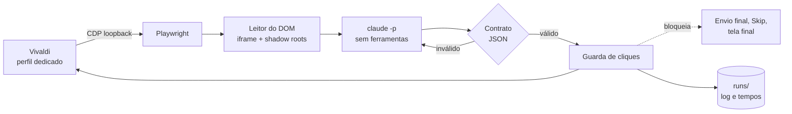

<div align="center">

# DRACAENA

Um assistente local para atividades do NetAcad, feito em Python com [Playwright](https://playwright.dev) e [Claude Code](https://claude.com/claude-code).<br>
Lê a questão direto do DOM, pergunta ao Claude, aplica a resposta por uma guarda de cliques e mede cada etapa do caminho.

[Funcionalidades](#funcionalidades) · [Como foi feito](#como-foi-feito) · [Desempenho](#desempenho) · [Instalar](#instalar) · [Uso](#uso) · [Configuração](#configuração) · [Problemas](#solução-de-problemas) · [Desenvolvimento](#desenvolvimento)


</div>

> [!NOTE]
> Este é um projeto **pessoal**, validado apenas em Arch Linux com Hyprland e Vivaldi. O nome dos comandos continua
> sendo `quiz-*`, herdado do nome original do projeto (`quiz-helper`). Leia a seção
> [Uso responsável](#uso-responsável) antes de rodar em qualquer avaliação.

<br>

O DRACAENA conecta ao Vivaldi por Chrome DevTools Protocol, entra no iframe da atividade do NetAcad, extrai a questão
atual dos componentes da página e entrega o enunciado ao Claude Code em modo não interativo. A resposta volta como JSON,
passa por um contrato que valida índices e quantidade de itens e só então chega à página, por uma guarda que concentra
todos os cliques. O envio final da avaliação nunca é feito pela ferramenta.

Não há OCR, captura de tela para leitura nem automação de mouse: a primeira versão do projeto trabalhava assim, e todo
esse caminho foi removido (58 arquivos) quando a leitura pelo DOM provou ser mais rápida e mais exata. Como os cliques
saem pelo CDP e não movem o cursor, o computador continua utilizável enquanto o loop roda.

## Funcionalidades

| | O que faz |
|---|---|
| **Leitura pelo DOM** | Percorre o iframe `authoring-resources` e os shadow roots abertos. Reconhece `mcq-view` (resposta única e múltipla), `matching-view` / `matching-dropdown-view` (listas de seleção) e `object-matching-view` (associação). |
| **Contrato de resposta** | O Claude responde em JSON de quatro tipos: `SINGLE`, `MULTI`, `DROPDOWN` e `MATCH`. Índices fora do intervalo, quantidade errada ou resposta mal formada derivam para uma segunda tentativa, nunca para um clique. |
| **Guarda de cliques** | Um único ponto aplica toda ação. Bloqueia envio final, confirmação de envio, Skip All, Skip Question e a tela final, e confere o alvo antes de agir. |
| **Loop com pausa** | `SUPER+P` inicia, pausa e retoma. Qualquer situação inesperada (atividade nova, figura ausente, marcação não confirmada) pausa e notifica, em vez de insistir. |
| **Segunda tentativa** | Nas seções do curso, que mostram feedback de acerto, a ferramenta reconsulta o Claude com o feedback, usa Reset e responde de novo. |
| **Dry-run** | `--dry-run` lê, consulta o Claude e simula os cliques sem tocar na página. |
| **Cronometragem** | Cada questão registra o tempo de leitura do DOM, do Claude, das ações, do Submit, da espera de avanço e do restante. `python -m quizhelper timings` resume tudo (rode com o Python do venv e `PYTHONPATH=lib`). |
| **Diagnóstico** | `quiz-doctor` confere venv, Playwright, Claude, prompts, symlinks, perfil, porta, endpoint CDP, aba, iframe e a leitura de uma questão, sem clicar e sem gastar cota. |
| **Privacidade** | Execuções em pastas `700` e arquivos `600`, credenciais reportadas só como `definida` ou `ausente`, CDP somente em loopback. |

## Como foi feito

O DRACAENA nasceu em um único dia, em uma esteira de agentes em que cada um tinha um papel fixo. O histórico público
tem 21 commits, quase todos entre 17h e 21h de 7 de novembro de 2026, e a divisão foi esta:

| Papel | Quem | O que fazia |
|---|---|---|
| **Operador** | Pedro | Define o objetivo, roda a ferramenta de verdade no NetAcad, cola logs e screenshots e decide cada merge. |
| **Analista e arquiteto** | Claude (conversa) | Inventaria o repositório, lê os logs de execução, formula hipóteses, descarta as erradas e escreve o prompt de cada tarefa com critérios de aceitação. |
| **Executor** | Codex | Recebe um prompt fechado, trabalha em uma branch, faz um commit por item, roda a suíte e devolve um relatório. Não faz push. |
| **Motor de resposta** | Claude Code | Roda dentro do produto: cada questão é uma chamada `claude -p` isolada. |

O Claude Code aparece duas vezes, de propósito. Fora do produto ele ajuda a projetar e diagnosticar. Dentro do produto
ele é o motor que responde, restrito por `--safe-mode --tools '' --strict-mcp-config --no-chrome
--disable-slash-commands --no-session-persistence`, ou seja, sem ferramentas, sem MCP, sem navegador e sem memória entre
perguntas. Só essa poda de contexto levou cada consulta de 4,5 s para 3,3 s nas medições registradas no código.

O ciclo de trabalho se repetiu cinco vezes:

1. O operador roda de verdade e cola o que viu, com log e imagem.
2. O analista lê `run.log`, `questions.jsonl` e as saídas do Claude, e isola a causa.
3. O analista escreve um prompt com escopo, arquivos permitidos, testes exigidos e o que não pode mudar.
4. O executor entrega uma branch com um commit por item e um relatório.
5. O operador confere os testes, faz o merge e repete o teste real.

Esse ciclo produziu, nesta ordem, a faxina do código legado, a correção dos dropdowns, a correção do dry-run, a
deduplicação com instalador mais rigoroso e o reconhecimento do processo do Vivaldi no diagnóstico.

### O que os logs revelaram

Três defeitos só apareceram por leitura de log, e nenhum teria sido achado sem a execução real:

- **Dropdown embaralhado.** O DOM entrega as opções numa ordem e o atributo `data-index` em outra. A extração usava a
  posição e a confirmação usava o índice, então o Claude acertava e a página mostrava outra opção. A correção ordena
  por `data-index` e passa a confirmar também pelo texto exibido. Havia 14 questões de dropdown nos logs até então.
- **Dry-run que acusava erro.** A simulação esperava que a página confirmasse um clique que nunca aconteceu e
  notificava "marcação não confirmada". Agora a confirmação é dada como válida quando a guarda está simulando.
- **Diagnóstico com falso negativo.** O `quiz-doctor` procurava a flag do perfil como item separado em
  `/proc/<pid>/cmdline`, mas o Vivaldi reescreve a linha de comando do processo principal como um texto único separado
  por espaços. A comparação agora aceita as duas formas e ignora processos auxiliares (`--type=`).

Mais de 60 testes automatizados cobrem a guarda, o contrato, as ações de dropdown e dry-run, o diagnóstico e o
instalador. Rodam em Python 3.10 e 3.14 na CI, com fixtures HTML sintéticas e sem conta real.

## Desempenho

Todos os números abaixo vêm dos registros reais de `questions.jsonl`: **527 questões em 48 execuções**, sendo 474 de
avaliações e 53 de seções do curso, com o modelo `haiku`.

### Tempo por questão

| Métrica | Valor |
|---|---|
| Média | **4,42 s** |
| Mediana | 4,26 s |
| Percentil 90 | 5,84 s |
| Maior execução contínua | 60 questões |

### Onde o tempo vai

| Etapa | Média |
|---|---|
| Consulta ao Claude | 4,07 s (mediana 3,90 s, p90 5,31 s, máximo 12,71 s) |
| Espera pelo avanço da página | 0,230 s |
| Ações de clique | 0,119 s (mediana 0,041 s) |
| Submit | 0,025 s |
| Leitura do DOM | 0,004 s |
| Tudo fora do Claude | **0,364 s** |

O Claude responde por 91,8% do tempo de cada questão. Ler, clicar e avançar somam menos de meio segundo, o que
significa que qualquer ganho futuro de velocidade está na escolha do modelo e no tamanho do prompt, não na automação.

### Por tipo de questão

| Tipo | Questões | Claude (média) |
|---|---|---|
| `SINGLE` | 362 | 4,0 s |
| `MULTI` | 104 | 4,3 s |
| `DROPDOWN` | 14 | 4,2 s |
| `MATCH` | 47 | 4,4 s |

### Precisão

Nas 53 questões de seções do curso, que exibem feedback de acerto e por isso podem ser conferidas, a ferramenta acertou
**53 de 53**, sem precisar da segunda tentativa. Nas 474 questões de avaliação a página não informa o resultado, então
**não existe taxa de acerto medida** para elas, e este README não estima uma.

## Comparação entre modelos

Só o `haiku` foi medido. Os demais modelos entram na tabela abaixo quando houver dados de uso real, e as células vazias
são intencionais: preencher com estimativa seria o oposto do que o projeto faz com o resto dos números.

| Modelo | Claude (média) | p90 | Precisão nas seções | Questões medidas |
|---|---|---|---|---|
| `haiku` (padrão) | 4,07 s | 5,31 s | 53/53 | 527 |
| `sonnet` | não medido | não medido | não medido | 0 |
| `opus` | não medido | não medido | não medido | 0 |

Uma observação que já está nos dados: as 17 consultas em que o Claude gastou raciocínio estendido levaram em média
4,9 s, contra 4,0 s nas 510 sem ele. O modelo padrão é uma escolha de latência, e `MODEL` e `RETRY_MODEL` na
configuração permitem usar um modelo maior só na segunda tentativa.

## Instalar

Requisitos: Python 3.10+ com `venv`, Bash, `curl`, `ss`, `flock` e `setsid`, Vivaldi (`vivaldi-stable`) e o Claude Code
instalado e autenticado (`claude auth login`). São opcionais `notify-send`, `wl-copy` e o Hyprland para os atalhos.

```sh
git clone https://github.com/Pedrojscx/dracaena.git ~/src/dracaena
cd ~/src/dracaena
./install.sh --check     # só verifica as dependências
./install.sh             # venv privado, quatro symlinks e configuração inicial
```

O instalador é idempotente: não usa `sudo`, não instala pacotes do sistema, não baixa navegador, não sobrescreve a
configuração pessoal e não edita o Hyprland. Ele grava em `~/.config/quiz-helper/paths` o caminho do `claude`, porque
os atalhos do Hyprland não herdam o `PATH` do terminal. Para remover tudo: `./uninstall.sh`.

## Uso

```sh
quiz-browser        # abre o Vivaldi com perfil dedicado e CDP em 127.0.0.1:9222
                    # faça login no NetAcad e abra UMA aba /launch com a atividade
quiz-doctor         # confere o ambiente inteiro, sem clicar
quiz-loop --dry-run # lê e consulta o Claude, mas não clica
quiz-loop           # responde de verdade
```

O login e o início da avaliação são manuais, no perfil dedicado. Depois disso o loop trabalha sozinho até a tela final.

### Atalhos

Opcionais, em `config/hyprland-binds.conf` (Hyprland clássico) e `config/hyprland-binds.lua` (configuração Lua).

| Atalho | Comando | Ação |
|---|---|---|
| <kbd>SUPER</kbd> + <kbd>P</kbd> | `quiz-loop` | Inicia; se já estiver rodando, pausa ou retoma |
| <kbd>SUPER</kbd> + <kbd>SHIFT</kbd> + <kbd>P</kbd> | `quiz-ask` | Responde só a questão atual, notifica e copia a resposta, sem clicar |

### Comandos

| Comando | Comportamento |
|---|---|
| `quiz-browser [URL]` | Abre o perfil dedicado, ou uma aba no navegador CDP já disponível |
| `quiz-browser --status` | Verifica a escuta em loopback e o `/json/version` |
| `quiz-loop --status` / `--stop` | Informa se está rodando / encerra |
| `quiz-loop --once` | Processa somente uma questão |
| `quiz-loop --dry-run` | Consulta e simula as ações |
| `quiz-ask` | Consulta a questão atual e notifica a resposta |
| `quiz-doctor` | Diagnóstico somente leitura |
| `quiz-doctor env` | Compara consultas sintéticas feitas pelo terminal e pelo Hyprland (consome cota) |

## Como funciona



Nas avaliações, a questão atual vem da faixa de navegação e do contador. Nas seções do curso, do bloco indicado pelo
título da aba. Figuras relevantes são capturadas do elemento da questão e enviadas ao Claude junto com o texto, e a
falta de uma figura exigida pausa o loop.

## Configuração

O padrão fica em `config/quiz-helper.conf` e é copiado para `~/.config/quiz-helper/config` na primeira instalação.
Formato `CHAVE=VALOR`.

| Chave | Padrão | Efeito |
|---|---|---|
| `MODEL` | `haiku` | Modelo usado em `claude -p --model` |
| `RETRY_MODEL` | vazio | Modelo da segunda tentativa (vazio usa `MODEL`) |
| `CLAUDE_TIMEOUT` | `45` | Teto, em segundos, de cada chamada |
| `CDP_PORT` | `9222` | Porta do DevTools, sempre em `127.0.0.1` |
| `BROWSER_BIN` | `vivaldi-stable` | Navegador aberto pelo `quiz-browser` |
| `CLICK_SUBMIT` | `1` | `1` envia a questão atual; `0` marca e pausa |
| `RETRY_ON_INCORRECT` | `1` | Reconsulta com o feedback nas seções do curso |
| `KEEP_DAYS` | `7` | Idade máxima das pastas de execução |

`CLICK_SUBMIT` nunca autoriza o envio final da avaliação.

## Registros e privacidade

Cada execução gera `runs/<data>[-dryrun]/` com `run.log`, `questions.jsonl` e a saída crua do Claude por questão
(`claude/Q001.txt`). Esses arquivos podem conter enunciados, respostas e caminhos locais, ficam fora do Git e são
apagados ao iniciar um novo loop quando passam de `KEEP_DAYS`.

A porta CDP controla um perfil autenticado. Mesmo em loopback, qualquer processo local que a alcance tem esse poder, então
não a exponha nem a encaminhe. O lançador recusa escuta fora de `127.0.0.1`.

## Solução de problemas

<details>
<summary><b>"pausado: dropdown não mostra a opção escolhida"</b></summary>

Era o defeito de ordem das opções, corrigido. Se voltar, atualize o repositório, rode `quiz-doctor` e envie o
`questions.jsonl` da execução, que traz as opções na ordem lida e o texto exibido.

</details>

<details>
<summary><b>"marcação não confirmada" depois de um <code>--dry-run</code></b></summary>

Também corrigido: o dry-run não clica, então não há o que confirmar. A pausa ao fim da simulação é intencional.

</details>

<details>
<summary><b><code>[FALHA] navegador com perfil dedicado e porta configurada</code></b></summary>

Confira se o Vivaldi foi aberto pelo `quiz-browser` e não por outro atalho. O diagnóstico compara o perfil e a porta com
a linha de comando do processo principal, e um navegador aberto sem esses argumentos não passa. Um Vivaldi já aberto
antes de rodar o `quiz-browser` precisa ser fechado e reaberto por ele.

</details>

<details>
<summary><b>Autenticação do Claude ou do NetAcad expirou</b></summary>

Pause o loop, rode `claude auth login` no terminal e repita `quiz-doctor`. Para o NetAcad, entre de novo no perfil aberto
pelo `quiz-browser`, volte à atividade e retome à mão.

</details>

<details>
<summary><b>Mudanças no NetAcad</b></summary>

Componentes novos, mais de uma aba compatível, navegação durante uma ação e respostas inválidas pausam o loop. O
leitor depende da estrutura atual da página, e uma mudança de lá pode exigir ajuste aqui. A ferramenta não garante acerto.

</details>

## Desenvolvimento

```sh
PYTHON="${XDG_DATA_HOME:-$HOME/.local/share}/quiz-helper/venv/bin/python"
"$PYTHON" -m pip install -r requirements-dev.txt
"$PYTHON" -m playwright install --only-shell chromium   # só para os testes da guarda
tests/run.sh
```

A suíte roda ShellCheck, compilação Python, `unittest` e `tests/check_publication.py`, que procura credenciais e arquivos
pessoais. Usa fixtures HTML sintéticas, mocks dos comandos externos e `HOME` temporário: não toca em conta real, não chama
o Claude e não usa o perfil do Vivaldi. A GitHub Action executa a mesma suíte em Python 3.10 e 3.14.

Convenções do projeto: uma branch por tarefa, um commit por item, nada de `git add -f` em perfis, cookies, `.env`,
`runs/` ou capturas reais.

## Uso responsável

O DRACAENA automatiza respostas em uma plataforma de ensino. Usá-lo em avaliações pode violar os termos da Cisco
Networking Academy e as regras da sua instituição, com consequências acadêmicas que são só suas. O projeto bloqueia o
envio final de propósito, mas isso não o torna adequado para fraudar uma prova. Use-o em atividades de estudo e em
contas e cursos onde você tem autorização para isso.

O projeto ainda não tem licença definida, então por padrão todos os direitos são reservados.

<br>

<div align="center">
<sub>DRACAENA · feito por Pedro Lucas em Arch Linux, com orquestração de Claude Code e Codex</sub>
</div>
