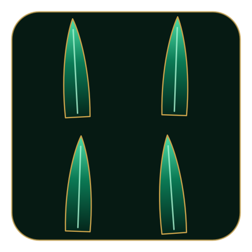
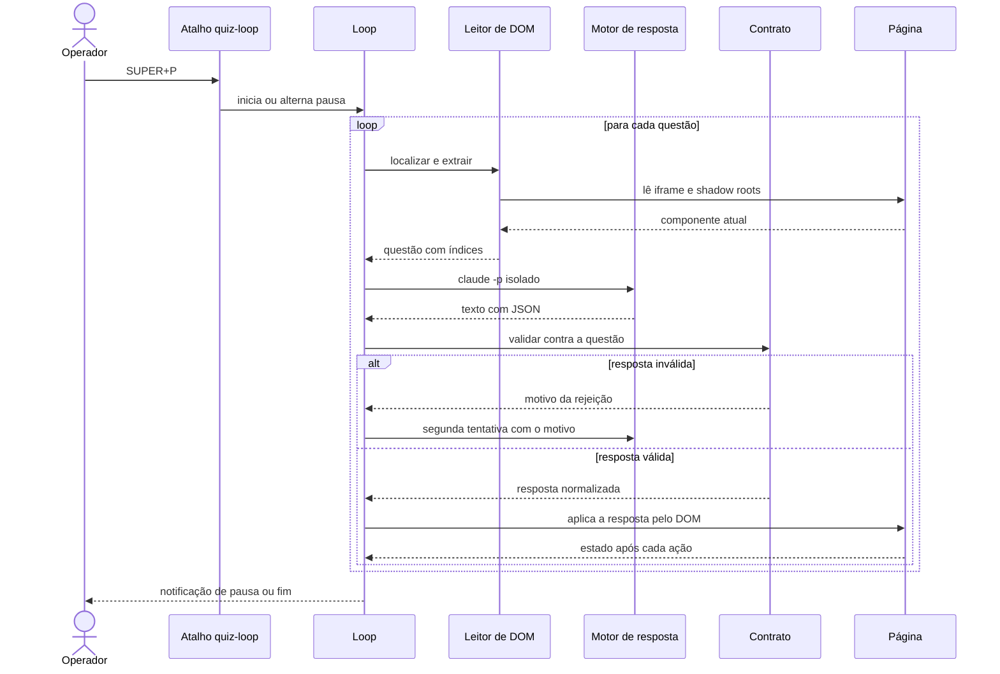
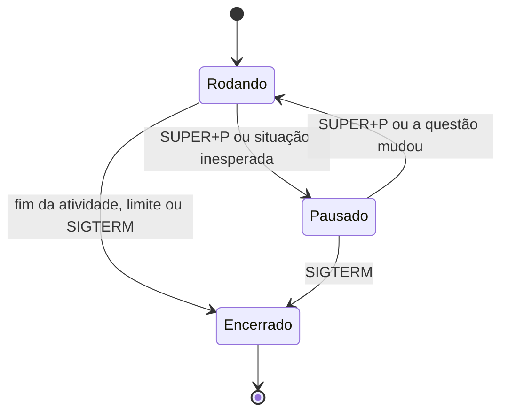
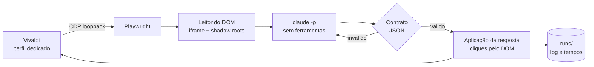

<div align="center">


**Automação de interface via Chrome DevTools Protocol: leitura estruturada do DOM, contrato de resposta validado, loop com pausa e instrumentação.**


<a href="https://github.com/Pedrojscx/dracaena/actions/workflows/checks.yml"></a>


[Funcionalidades](#-funcionalidades) · [Por que o nome?](#-por-que-o-nome) · [Como foi feito](#-como-foi-feito) · [Conceitos](#-conceitos-por-trás-da-técnica) · [Arquitetura](#-arquitetura-e-decisões-técnicas) · [Desempenho](#-desempenho) · [Instalar](#-instalar) · [Uso](#-uso) · [Configuração](#-configuração) · [Problemas](#-solução-de-problemas) · [Desenvolvimento](#-desenvolvimento) · [Uso responsável](#-uso-responsável)

</div>

---

> [!NOTE]
> Este é um projeto **pessoal**, validado apenas em Arch Linux com Hyprland e Vivaldi. O nome dos comandos continua
> sendo `quiz-*`, herdado do nome original do projeto (`quiz-helper`). Leia a seção
> [Uso responsável](#-uso-responsável) antes de usar.

O DRACAENA é uma ferramenta em Python que lê e responde atividades do NetAcad. Ela se conecta, por Chrome DevTools
Protocol, a um navegador já aberto, lê o estado da página como dados estruturados (atravessando o iframe da atividade e
os shadow roots abertos), entrega o enunciado ao Claude Code em modo não interativo e aplica a resposta na página,
conferindo o resultado de cada ação. A resposta volta como JSON e só chega à página depois de passar por um contrato que
valida tipo, índices, quantidade e formato. Um loop com pausa cuida das situações inesperadas, e cada etapa é
cronometrada.

A ferramenta foi desenvolvida e testada no NetAcad, o ambiente em que a página real foi observada; o conhecimento sobre
a estrutura dela está concentrado em `lib/quizhelper/dom.py` e `lib/quizhelper/browser.py`. O texto da questão vem do DOM, e
não de OCR; só as figuras que o enunciado manda consultar são capturadas do próprio elemento e enviadas como imagem.
Como os cliques saem por CDP e não movem o cursor, o computador continua utilizável enquanto o loop roda.

## ✨ Funcionalidades

| | O que faz |
|---|---|
| **Leitura pelo DOM** | Percorre o iframe `authoring-resources` e os shadow roots abertos. Reconhece `mcq-view` (resposta única e múltipla), `matching-view` / `matching-dropdown-view` (listas de seleção) e `object-matching-view` (associação). |
| **Contrato de resposta** | O Claude responde em JSON de quatro tipos: `SINGLE`, `MULTI`, `DROPDOWN` e `MATCH`. Índices fora do intervalo, quantidade errada ou resposta mal formada derivam para uma segunda tentativa, nunca para um clique. |
| **Loop com pausa** | `SUPER+P` inicia, pausa e retoma. Qualquer situação inesperada (atividade nova, figura ausente, marcação não confirmada) pausa e notifica, em vez de insistir. |
| **Segunda tentativa** | Onde a página mostra feedback de acerto, a ferramenta reconsulta o Claude com o feedback, usa Reset e responde de novo. |
| **Resposta avulsa** | `quiz-ask` responde só a questão atual, notifica e copia a resposta, sem clicar. |
| **Dry-run** | `--dry-run` lê, consulta o Claude e simula os cliques sem tocar na página. |
| **Cronometragem** | Cada questão registra o tempo de leitura do DOM, do Claude, das ações, do Submit, da espera de avanço e do restante. `python -m quizhelper timings <pasta da execução>` resume tudo (rode com o Python do venv e `PYTHONPATH=lib`). |
| **Diagnóstico** | `quiz-doctor` confere venv, Playwright, Claude, prompts, symlinks, perfil, porta, endpoint CDP, aba, iframe e a leitura de uma questão, sem clicar e sem consultar o Claude. |
| **Privacidade** | Execuções em pastas `700` e arquivos `600`, credenciais reportadas só como `definida` ou `ausente`, CDP somente em loopback. |

## 🐉 Por que o nome?



*Dracaena* é o gênero da espada de São Jorge (*Dracaena trifasciata*), planta que por muito tempo levou o nome de *Sansevieria*; a genética mostrou, em 2017, que as sansevierias são uma linhagem suculenta dentro do próprio gênero. O nome científico vem do grego *drákaina*, "dragoa", e costuma ser ligado à resina vermelha, o "sangue de dragão", que algumas espécies do gênero produzem. O nome popular brasileiro nasce da folha: longa, rígida e pontiaguda, ela sobe em lâmina, como uma espada fincada na terra.

Jorge foi um soldado romano de origem capadócia, oficial de bravura reconhecida que, por volta do ano 303, sob o imperador Diocleciano, preferiu o martírio a renegar a fé. Desde então é lembrado como mártir e como cavaleiro, padroeiro de soldados e cavaleiros e de nações como a Inglaterra. A devoção chegou ao Brasil pelas mãos de Portugal, e o seu dia é 23 de abril.

Sobre ele corre a **lenda** que a Idade Média tornou célebre, e que não pertence à história documentada: um cavaleiro de armadura reluzente, lança em punho, avança sozinho contra o dragão que aterrorizava uma cidade e não recua diante do monstro. É uma imagem de coragem, contada e recontada por séculos, e é como imagem, com respeito, que ela entra aqui.

---

## 🧪 Como foi feito

O DRACAENA foi desenvolvido por um processo assistido por agentes de IA, com papéis separados e uma única pessoa decidindo
o que entra. A separação tem uma razão prática: quem lê logs e formula hipóteses não deve ser quem escreve o código, e
quem escreve o código não deve ser quem o revisa.

| Papel | Quem | Responsabilidade |
|---|---|---|
| **Operador** | Pedro | Define o objetivo, executa a ferramenta num ambiente real, formula e descarta hipóteses e redige a especificação de cada tarefa e decide cada merge. |
| **Analista e arquiteto** | Claude (conversa) | Inventaria o repositório, lê os registros de execução, fornece logs e capturas.|
| **Codificador** | Claude Code (CLI) | Codifica e analisa a aplicação com escopo e critérios de aceitação para cada tarefa.| 
| **Motor de resposta** | Claude Code | Roda dentro do produto: cada consulta é uma chamada `claude -p` isolada (ver [Motor de resposta isolado](#4-motor-de-resposta-isolado)). |

<!-- confirmar com o autor
Papel "Executor" (Codex): recebe uma especificação fechada, trabalha numa branch, faz um commit por item, roda a suíte,
devolve um relatório e não faz push. Só reinserir na tabela acima, entre Analista e Motor de resposta, depois que o autor confirmar.
-->

O Claude Code aparece em dois lugares de propósito: fora do produto, ajudando a projetar e diagnosticar; dentro dele, como
componente restrito e sem memória entre consultas.

### Ciclo de trabalho

Cada tarefa seguiu o mesmo ciclo de cinco passos:

1. **Observação.** O operador roda a ferramenta num ambiente real e entrega o que viu: log, `questions.jsonl` e capturas.
2. **Diagnóstico.** O analista lê `run.log`, `questions.jsonl` e as saídas cruas do Claude, isola a causa e confirma no código.
3. **Especificação.** O analista escreve a tarefa com escopo, arquivos permitidos, testes exigidos e o que não pode mudar.
4. **Execução.** A mudança chega numa branch, com um commit por item e um relatório do que foi feito e do que não foi possível fazer.
5. **Aceitação.** O operador confere o relatório, roda a suíte, faz o merge e repete a execução real que originou a tarefa.

O critério de aceitação de cada tarefa tem duas partes: a suíte offline passa (incluindo um teste novo que reproduz o
defeito) e a situação real que o originou deixa de ocorrer. Sem as duas, a tarefa volta ao passo 2.

### Defeitos encontrados em execução real

Os três defeitos abaixo só apareceram com a ferramenta rodando contra a página de verdade. Cada um virou teste.

<details>
<summary><b>1. Dropdown com ordem de opções diferente de <code>data-index</code></b></summary>

- **Sintoma.** O loop pausava com "dropdown não mostra a opção escolhida", embora a opção certa tivesse sido clicada.
- **Causa.** Na página, os `<li role=option>` de um dropdown podem vir numa ordem do DOM diferente do atributo
  `data-index`. A extração em `lib/quizhelper/dom.py` mantinha as opções na ordem do DOM, mas o clique usa `data-index` e
  o contrato fala em índice; a conferência em `lib/quizhelper/actions.py` indexava a lista por posição
  (`options[o]`) e olhava, portanto, a opção errada.
- **Correção.** A extração ordena as opções por `data-index`, e a conferência passa a aceitar também o texto exibido no
  botão do dropdown (`shown`), que não depende de `aria-selected` estar atualizado. Commit `6621504`.
- **Teste.** `tests/py/test_dropdown.py`, com uma fixture em que a ordem do DOM é invertida: confere a ordenação, a seleção
  sem pausa e o caso em que só o texto exibido confirma a escolha.

</details>

<details>
<summary><b>2. Dry-run que acusava erro por esperar a confirmação de um clique inexistente</b></summary>

- **Sintoma.** Em `--dry-run`, a simulação terminava em pausa por marcação não confirmada.
- **Causa.** No modo de simulação nada é clicado, mas o executor de ações (`Actor`) ainda esperava que o DOM refletisse o
  clique, e a conferência nunca podia passar.
- **Correção.** Em `lib/quizhelper/actions.py`, `_confirm` devolve verdadeiro de imediato quando o modo de simulação está
  ativo. Commit `f4eaa2e`.
- **Teste.** `tests/py/test_dry_run.py` aplica uma resposta de cada tipo em modo de simulação e verifica que nenhum
  clique aconteceu, que a página ficou intacta, que nenhuma espera foi feita e que o log tem uma linha por ação simulada.

</details>

<details>
<summary><b>3. Diagnóstico que não reconhecia a flag do perfil</b></summary>

- **Sintoma.** `quiz-doctor` reportava "navegador com perfil dedicado e porta configurada" como falha, com o navegador
  aberto corretamente pelo `quiz-browser`.
- **Causa.** O diagnóstico lê `/proc/<pid>/cmdline` e comparava cada argumento separado por NUL. O Vivaldi reescreve a
  linha de comando do processo principal como um texto único (o comentário em `cmdline_matches` registra esse formato),
  então a comparação nunca encontrava as flags.
- **Correção.** `cmdline_matches`, em `lib/quizhelper/doctor.py`, aceita as duas formas, exige a flag com limites de
  argumento (para `--remote-debugging-port=92220` não casar com 9222) e ignora processos auxiliares com `--type=`.
  Commit `339bd43`. No formato de texto único, espaços em caminhos são ambíguos; o código registra essa limitação.
- **Teste.** `CmdlineMatchesTest`, em `tests/py/test_doctor.py`: argumentos separados por NUL e por espaço, porta e perfil
  diferentes, prefixo de valor, processo auxiliar e caracteres especiais no caminho.

</details>

---

## 📚 Conceitos por trás da técnica

Quatro ideias sustentam o projeto: o DOM, o iframe, o shadow DOM e o protocolo CDP. Quem já as conhece pode seguir direto
para a [arquitetura](#-arquitetura-e-decisões-técnicas); quem não conhece encontra aqui o mínimo para entender por que o
código é escrito do jeito que é.

### DOM

O DOM (*Document Object Model*) é a árvore de objetos que o navegador monta a partir do HTML. Ele é o estado atual da
página, depois de o JavaScript ter rodado e alterado nós, classes e atributos, e não o código-fonte que chegou pela
rede. É por isso que ler o DOM mostra o que o usuário vê (qual alternativa está marcada, qual botão está desabilitado),
enquanto o texto do HTML original não mostra.

```html
<!-- versão simplificada -->
<div class="mcq__item" role="radio" aria-checked="false">Alternativa A</div>
```

```js
// versão simplificada: depois de um clique, o mesmo nó passa a dizer outra coisa
document.querySelector('.mcq__item').getAttribute('aria-checked')   // "true"
```

### Iframe

Um `<iframe>` embute outro documento dentro da página. Esse documento tem o próprio DOM, separado do da página externa:
`document.querySelector` da página de fora não enxerga nada que esteja lá dentro. O navegador ainda aplica a política de
mesma origem, que só deixa o script de um documento alcançar o DOM de outro quando os dois têm o mesmo esquema, host e
porta. Aqui o conteúdo da atividade vive num iframe de mesma origem da página (`www.netacad.com`, como registram a
constante `QUIZ_FRAME` e o comentário de `lib/quizhelper/dom.py`), então o código pode rodar JavaScript dentro dele. O
Playwright expõe cada iframe como um `Frame`, e `lib/quizhelper/browser.py` escolhe o certo pela URL:

```python
# lib/quizhelper/browser.py
QUIZ_FRAME = "https://www.netacad.com/authoring-resources/index.html"
```

```python
# lib/quizhelper/browser.py
def quiz_frame(page):
    for f in page.frames:
        if f.url.startswith(QUIZ_FRAME):
            return f
    return None
```

### Shadow DOM

Web Components podem esconder a própria estrutura interna num *shadow root*, criado com `attachShadow`. O elemento que o
hospeda continua na árvore normal, mas o conteúdo fica numa subárvore à parte, com estilos e seletores isolados. No modo
`open`, `element.shadowRoot` devolve essa subárvore; no modo `closed`, devolve `null`, e não há como entrar. Uma busca
comum (`querySelectorAll`) não atravessa a fronteira: ela vê o host, mas não o que está dentro. Por isso o leitor do
DOM precisa descer explicitamente em cada `shadowRoot`, e só funciona onde ele está aberto.

```js
// versão simplificada
const host = document.querySelector('mcq-view');   // o elemento que hospeda
host.shadowRoot                                      // ShadowRoot (modo open); null se fosse closed
host.shadowRoot.querySelector('.mcq__item')          // só se alcança por dentro dele
```

Nos testes, as páginas sintéticas declaram o shadow root direto no HTML, pela forma declarativa
`<template shadowrootmode="open">`, em `tests/fixtures/derived.py`:

```python
# tests/fixtures/derived.py
def shadow(tag: str, inner: str, attrs: str = "") -> str:
    return f'<{tag}{(" " + attrs) if attrs else ""}><template shadowrootmode="open">{inner}</template></{tag}>'
```

Como `tests/py/web.py` registra, esse shadow DOM declarativo só é montado quando a página é carregada por URL, e por isso
as fixtures são servidas por um servidor HTTP local.

### CDP

O Chrome DevTools Protocol é o protocolo que as ferramentas de desenvolvedor do Chromium usam para inspecionar e
controlar o navegador. As mensagens são JSON trocadas por WebSocket e organizadas em domínios: `Page` (navegação), `DOM`
(a árvore), `Runtime` (executar JavaScript), `Input` (teclado e mouse), `Network` (requisições), entre outros. Um comando, em
versão simplificada, tem este aspecto:

```json
{"id": 1, "method": "Runtime.evaluate", "params": {"expression": "document.title"}}
```

O navegador só aceita esse controle se for aberto com `--remote-debugging-port`. A flag publica um endpoint HTTP, e o
`/json/version` devolve, entre outros campos, o `Browser`, o `Protocol-Version` e o `webSocketDebuggerUrl`, o endereço
do WebSocket (algo como `ws://127.0.0.1:9222/devtools/browser/<id>`). O projeto não monta mensagens CDP à mão: usa o
Playwright, que se anexa a um navegador já aberto com `connect_over_cdp` e traduz suas chamadas para o protocolo.

```python
# lib/quizhelper/browser.py
def connect(pw, port: int):
    return pw.chromium.connect_over_cdp(f"http://127.0.0.1:{port}", timeout=15000)
```

Os cliques não movem o cursor físico porque são executados dentro da página, como JavaScript (`hit.click()`, em
`_DOM_CLICK`, no `lib/quizhelper/guard.py`), e não como eventos do sistema operacional. A contrapartida é de segurança:
quem alcança a porta de depuração controla o navegador inteiro, inclusive com as sessões em que o usuário já está logado.
Por isso a porta fica em loopback e num perfil dedicado (detalhes na seção de [segurança](#8-segurança-e-privacidade)).

---

## 🧱 Arquitetura e decisões técnicas

Cada subseção aponta o arquivo onde o assunto vive e explica o porquê da escolha. O princípio comum: uma falha de
interpretação, de leitura ou de rede deve terminar em pausa e notificação, não em insistência.

<details>
<summary><b>Diagrama de sequência</b></summary>



</details>

### 1. Conexão por CDP

*Arquivos: `lib/quizhelper/browser.py`, `lib/quizhelper/cdp.py`, `bin/quiz-browser`.*

O Playwright se conecta a um navegador já aberto com `connect_over_cdp`, em vez de lançar um navegador próprio, e assim a
sessão autenticada do perfil é reaproveitada e nenhum movimento de mouse é necessário. O navegador roda num perfil
dedicado (`vivaldi-profile`, na pasta de dados), porque o Chromium 136 em diante ignora a depuração remota no perfil
padrão (comentário de `bin/quiz-browser`). A porta fica em `127.0.0.1`: o lançador passa
`--remote-debugging-address=127.0.0.1`, confere com `ss` quem está escutando, recusa subir se a porta já escuta em outro
endereço e fecha o navegador que abriu se ela escutar fora do loopback durante a subida. Já `cdp.py` valida o
`/json/version` sem seguir redirects nem proxies e exige um WebSocket de loopback na mesma porta, com caminho
`/devtools/browser/`. Os testes `tests/py/test_cdp.py` e `tests/py/test_browser_command.py` cobrem essas recusas.

### 2. Leitura do DOM

*Arquivo: `lib/quizhelper/dom.py`.*

O leitor injeta um conjunto de funções JavaScript (o `PRELUDE`, objeto `QH`) a cada `evaluate` dentro do iframe. A
primeira peça é a descida: `QH.all` percorre os elementos de um root e, para cada um que tem `shadowRoot`, entra nele
recursivamente.

```js
// lib/quizhelper/dom.py (PRELUDE)
  all(root, pred) { const out = []; const walk = (r) => { for (const e of r.querySelectorAll('*')) {
      if (pred(e)) out.push(e); if (e.shadowRoot) walk(e.shadowRoot); } };
      walk(root); if (root.shadowRoot) walk(root.shadowRoot); return out; },
```

A volta é a subida pela árvore. Num shadow root, `parentElement` termina na borda, então `QH.parent` sai dela pelo
`getRootNode().host`, e `QH.chain` junta todos os ancestrais até o topo (usado, por exemplo, para saber se um elemento
está visível):

```js
// lib/quizhelper/dom.py (PRELUDE)
  parent(e) { if (e.parentElement) return e.parentElement; const r = e.getRootNode(); return r && r.host ? r.host : null; },
  chain(e) { const out = []; let c = e; while (c) { out.push(c); c = QH.parent(c); } return out; },
```

Um componente de questão é reconhecido pelo shadow root que contém um nó `.is-question`, e a questão "na tela" é a que
está dentro da largura da janela:

```js
// lib/quizhelper/dom.py (PRELUDE)
  isQuestionHost(e) { return !!(e.shadowRoot && e.shadowRoot.querySelector(':scope > .is-question, .component.is-question')); },
  onScreen(e) { if (!QH.visible(e)) return false; const r = e.getBoundingClientRect();
      return r.right > 0 && r.left < innerWidth; },
```

Em atividades em carrossel, todas as questões ficam no DOM, deslocadas na horizontal. A atual é a do botão com as classes
`block-button` e `active-block` na faixa de navegação (o `data-block-id` aponta o bloco), conferida pelo contador
"N of M"; se esse caminho falhar, o plano B escolhe o componente que está dentro da largura da janela. Em atividades de
página única, a questão atual é a do bloco cujo cabeçalho tem o nome do item, tirado do título da aba. As alternativas
são ordenadas por `aria-posinset` e as opções de dropdown por `data-index`, porque a posição no DOM e o índice do
atributo são coisas diferentes (foi o defeito 1 de [Como foi feito](#-como-foi-feito)):

```js
// lib/quizhelper/dom.py (extração do dropdown)
      const opts = Array.from(s.querySelectorAll('li[role=option]')).map(li => ({index: +li.dataset.index,
        text: QH.norm(Array.from(li.querySelector('.dropdown__item-inner').childNodes).filter(n => n.nodeType === 3).map(n => n.textContent).join(' ')),
        selected: li.getAttribute('aria-selected') === 'true'})).sort((a, b) => a.index - b.index);
```

Ler o DOM no lugar de fazer OCR entrega o texto exato e o estado dos controles (marcado, selecionado, desabilitado) sem
erro de reconhecimento. O caminho de OCR foi removido do repositório (commit `131366c`).

### 3. Contrato de resposta

*Arquivos: `lib/quizhelper/contract.py`, `prompts/answer.txt`.*

O Claude responde em JSON de quatro tipos, sempre por índice, nunca por casamento aproximado de texto. O formato é pedido em
`prompts/answer.txt`; abaixo, um exemplo mínimo de cada tipo, com valores de exemplo no lugar dos marcadores do prompt:

```json
{"type":"SINGLE","answers":[2]}
{"type":"MULTI","answers":[0,3]}
{"type":"DROPDOWN","items":[{"item":0,"option":1},{"item":1,"option":0}]}
{"type":"MATCH","pairs":[{"right":0,"left":"C"},{"right":1,"left":"A"}]}
```

`parse_validated` extrai da saída o último objeto JSON que passa na validação (o prompt permite até três linhas de
raciocínio antes dele) e, se nenhum passar, levanta o motivo do último:

```python
# lib/quizhelper/contract.py
def parse_validated(raw: str, q: dict) -> dict:
    """O último objeto JSON que passa na validação; se nenhum passar, levanta o motivo do último."""
    found = candidates(raw)
    if not found:
        raise ContractError("não há nenhum objeto JSON na resposta")
    first_err: ContractError | None = None
    for data in reversed(found):
        try:
            return validate(data, q)
        except ContractError as exc:
            first_err = first_err or exc
    raise first_err  # type: ignore[misc]

```

`validate` confere: tipo igual ao da questão; inteiros (um booleano é recusado); índices dentro do intervalo e sem
repetição; quantidade igual à pedida (uma alternativa em `SINGLE`, a quantidade do enunciado em `MULTI`); todos os itens
de dropdown respondidos, com opção existente; e todas as linhas da direita de `MATCH` ligadas a uma letra que existe.
Uma resposta rejeitada gera uma segunda consulta com o motivo (`prompts/invalid.txt`); se falhar de novo, o loop pausa
com "resposta inválida duas vezes". Nada que reprovou na validação chega à página, porque um índice errado seria um
clique errado. Opcionalmente, `CLAUDE_SCHEMA=1` pede a saída estruturada com `--json-schema` (`schema_for`); o padrão é
texto livre com o parser tolerante.

### 4. Motor de resposta isolado

*Arquivo: `lib/quizhelper/claude.py`.*

Cada questão é uma chamada `claude -p` independente, sem estado entre elas, executada numa pasta vazia do diretório de
runtime (`$XDG_RUNTIME_DIR/quiz-helper/claude-cwd`) e não no repositório. A linha de comando é montada em `build_cmd`:

```python
# lib/quizhelper/claude.py
    cmd = [claude_bin(cfg), "-p", "--model", model or model_for(cfg), "--tools", "", "--safe-mode",
           "--strict-mcp-config", "--no-chrome", "--disable-slash-commands", "--no-session-persistence",
           *fmt, "--system-prompt", system_prompt()]
```

As flags restritivas, conforme o comentário do módulo: `--tools ""` não dá nenhuma ferramenta ao modelo, `--safe-mode` dispensa
`CLAUDE.md`, skills, plugins, hooks, MCPs e comandos, `--strict-mcp-config`, `--no-chrome` e `--disable-slash-commands`
reforçam o isolamento, `--no-session-persistence` não grava sessão, e um prompt de sistema curto (`prompts/system.txt`)
substitui o padrão. O modelo só devolve texto, e a resposta de uma
questão não contamina a próxima. O `--bare` não é usado, porque nele a autenticação exigiria `ANTHROPIC_API_KEY` e o login
OAuth deixaria de valer. O mesmo comentário registra o efeito medido na versão 2.1.319 do Claude Code: a média foi de
4,5 s para 3,3 s por consulta, com a mesma resposta. A consulta tem teto de `CLAUDE_TIMEOUT` segundos e pode ser
interrompida por uma pausa, porque o processo é verificado a cada 100 ms.

### 5. Máquina de estados do loop

*Arquivo: `lib/quizhelper/loop.py`.*



O loop alterna entre **rodando**, **pausado** e **encerrado**. `SUPER+P` envia SIGUSR1 e alterna rodando e pausado;
SIGTERM e SIGINT encerram. O loop entra em pausa e notifica, com urgência crítica, quando a aba mudou de atividade,
quando uma figura exigida pelo enunciado não pôde ser capturada, quando uma marcação não é confirmada duas vezes, quando
o Submit não aparece ou continua desabilitado, quando a resposta é inválida duas vezes ou quando o Claude falha. Pausas
automáticas terminam sozinhas se a questão mudar (o operador respondeu à mão), e pausas do usuário só terminam com
`SUPER+P`. Pausar é preferível a insistir porque insistir, num estado que a ferramenta não entende, é como os erros se
repetem. Se o iframe some ou a aba navega, o loop espera a página estabilizar (até `RECOVER_TIMEOUT_MS`, em no máximo três
tentativas) antes de pausar. Uma questão já enviada nunca é reenviada (`last_key`), e o loop termina quando a atividade
acaba (todas as questões respondidas ou tela de resultado) ou ao atingir `MAX_QUESTIONS`. Onde a página mostra feedback e há
`RETRY_ON_INCORRECT=1`, uma resposta marcada como errada gera uma segunda tentativa com o feedback (`prompts/retry.txt`),
depois de usar o Reset do componente (`RESET_WORDS`); sem Reset, o loop pausa.

### 6. Dry-run

*Arquivos: `lib/quizhelper/guard.py`, `lib/quizhelper/actions.py`, `lib/quizhelper/loop.py`.*

Com `--dry-run`, o loop executa o caminho inteiro (leitura, consulta ao Claude, validação e aplicação), mas todo clique
passa por `Guard.click` com `dry_run=True`, que em vez de clicar registra uma linha "(dry-run) clicaria: ..." no log. O alvo
é localizado como numa execução real, e só o clique é omitido; por isso o dry-run exercita de verdade a localização dos
elementos, o que um modo de simulação separado não faria. Como nada muda na página, o `Actor` não espera confirmação nesse
modo (o defeito 2). Ao fim da questão, o loop grava o registro com o veredito "dry-run (nada enviado)" e pausa. A pasta
da execução ganha o sufixo `-dryrun`. O dry-run ainda consulta o Claude, então consome cota. O teste
`tests/py/test_dry_run.py` confere que nenhum clique acontece, que o DOM não muda e que há uma linha de log por ação
simulada.

### 7. Instrumentação

*Arquivos: `lib/quizhelper/loop.py`, `lib/quizhelper/cli.py`.*

Um `Timer` mede, por questão, a leitura do DOM, o Claude, as ações, o Submit, a espera de avanço e a espera de feedback, e
soma o que está fora do Claude. O resultado vai para o campo `timing` de cada linha de `questions.jsonl`, na pasta
`runs/<data>/` do diretório de dados (`~/.local/share/quiz-helper`, ou `XDG_DATA_HOME`), e para o `run.log`.
`python -m quizhelper timings <pasta da execução>` imprime uma tabela por questão e etapa (rode com o Python do venv e
`PYTHONPATH=lib`); `summary` agrega por tipo. Com eles dá para ver onde o tempo de cada questão é gasto (ver [Desempenho](#-desempenho)).

### 8. Segurança e privacidade

*Arquivos: `lib/quizhelper/private.py`, `lib/quizhelper/redact.py`, `tests/check_publication.py`.*

Pastas novas nascem `700` e arquivos `600` (`private.py`, que também abre com `O_NOFOLLOW` e por isso recusa escrever
por um symlink). Os diagnósticos mostram credenciais só como `definida` ou `ausente` (`redact.py`), e as mensagens de
erro do subprocesso passam pelo mesmo filtro. O CDP escuta só em loopback.

> [!WARNING]
> A porta de depuração controla um perfil autenticado. Mesmo em loopback, qualquer processo local que a alcance tem esse poder.
> Não a exponha nem a encaminhe.

Antes de publicar, `tests/check_publication.py` procura arquivos cobertos pelo `.gitignore` que estejam rastreados ou novos
e padrões de credenciais (tokens do GitHub, chaves `sk-` e `AKIA`, chaves privadas e atribuições do tipo
`password = "..."`), sem imprimir os valores encontrados. Ele não substitui revisão humana.

### 9. Instalação idempotente

*Arquivos: `install.sh`, `lib/sh/common.sh`.*

O instalador cria um venv privado na pasta de dados, instala nele as dependências de `requirements.txt`, cria links
simbólicos para cada executável de `bin/` em `~/.local/bin` e copia a configuração inicial. Pode ser repetido sem efeito
colateral: um link já correto é mantido, e um arquivo que existe e não é link é deixado como está, com aviso. De
propósito, não usa `sudo`, não instala pacotes do sistema nem navegador, não sobrescreve a configuração pessoal e não
edita o Hyprland (apenas imprime as linhas dos atalhos). Atalhos do Hyprland não herdam o `PATH` do terminal, então o
instalador grava o caminho do `claude` em `~/.config/quiz-helper/paths`, lido depois dos padrões do repositório e antes
da configuração pessoal. O `uninstall.sh` remove só os links que apontam para este repositório.

### 10. Estratégia de testes

*Arquivos: `tests/run.sh`, `tests/py/`, `tests/fixtures/`, `.github/workflows/checks.yml`.*

As páginas de teste são fixtures HTML sintéticas, geradas por `tests/fixtures/derived.py` com as tags e atributos que o
leitor espera, e um simulador (`tests/fixtures/html/sim.js`) reproduz marcar, Submit e avanço. Elas rodam num Chromium
headless do Playwright. Os comandos externos (`ss`, `curl`, o navegador, o `claude`) são simulados, e cada execução usa um
`HOME` temporário. `tests/run.sh` roda a checagem de sintaxe e o ShellCheck dos scripts, a compilação Python, o
`unittest` e a verificação de publicação; a CI executa a mesma suíte em Python 3.10 e 3.14. A suíte não cobre uma conta
real, o modelo real nem mudanças futuras no site: o teste de que a ferramenta funciona contra a página de verdade
continua sendo manual, com `quiz-doctor` e `--dry-run`.

### Decisões e alternativas

<details>
<summary><b>Tabela de decisões</b></summary>

| Decisão | Alternativa descartada | Motivo |
|---|---|---|
| Conectar a um navegador aberto por CDP | Lançar um navegador próprio | Reaproveita a sessão autenticada e não mexe no mouse (`browser.py`) |
| Ler o DOM | OCR sobre captura de tela | Texto e estado exatos; o código de OCR foi removido (`131366c`) |
| Resposta por índice, validada | Casar o texto da resposta de forma aproximada | Um índice fora do intervalo é detectável; um texto parecido não é (`contract.py`) |
| Clique feito no DOM, no elemento sob o alvo | Eventos de mouse do Playwright | O "estável" do Playwright espera quadros de animação, que o Chromium suspende com a janela em outro workspace ou coberta (comentário de `guard.py`) |
| Uma chamada `claude -p` por questão, sem ferramentas | Sessão persistente do Claude Code com ferramentas | Sem estado entre questões e menor latência medida (4,5 s para 3,3 s) |
| Dry-run pelo mesmo caminho das ações reais | Um modo de simulação separado | O teste cobre o código que roda de verdade |
| Pausar diante do inesperado | Repetir a ação até dar certo | Evita cliques repetidos ou fora de lugar |

</details>

---

## 🚀 Desempenho

Os valores abaixo vêm dos registros locais de `questions.jsonl` (execuções reais, sem contar dry-run). Esses registros ficam
fora do Git, então os números, arredondados, não podem ser reproduzidos a partir do repositório.

| Métrica | Valor |
|---|---|
| Tempo médio por questão | cerca de 4,5 s |
| Parcela desse tempo na consulta ao modelo | cerca de 90% |

O que sobra (ler o DOM, agir e esperar o avanço) é pequeno perto da consulta, então o ganho de velocidade está na escolha
do modelo (`MODEL` e `RETRY_MODEL` na configuração) e no tamanho do prompt, não na automação.

---

## 📦 Instalar

Requisitos: Python 3.10+ com `venv`, Bash, `curl`, `ss`, `flock` e `setsid`, Vivaldi (`vivaldi-stable`) e o Claude Code
instalado e autenticado (`claude auth login`). São opcionais `notify-send`, `wl-copy` e o Hyprland para os atalhos.

```sh
git clone https://github.com/Pedrojscx/dracaena.git ~/src/dracaena
cd ~/src/dracaena
./install.sh --check     # só verifica as dependências
./install.sh             # venv privado, quatro symlinks e configuração inicial
```

O instalador é idempotente: não usa `sudo`, não instala pacotes do sistema, não baixa navegador, não sobrescreve a
configuração pessoal e não edita o Hyprland. Ele grava em `~/.config/quiz-helper/paths` o caminho do `claude`, porque
os atalhos do Hyprland não herdam o `PATH` do terminal. Para remover tudo: `./uninstall.sh`.

## 🎯 Uso

> [!TIP]
> Comece por `quiz-doctor` e `quiz-loop --dry-run`: nenhum dos dois clica na página (o dry-run consulta o Claude, então gasta cota).

```sh
quiz-browser        # abre o Vivaldi com perfil dedicado e CDP em 127.0.0.1:9222
                    # faça login no NetAcad e abra UMA aba /launch com a atividade
quiz-doctor         # confere o ambiente inteiro, sem clicar
quiz-loop --dry-run # lê e consulta o Claude, mas não clica
quiz-loop           # responde de verdade
```

O login e o início da atividade são manuais, no perfil dedicado. Depois disso o loop trabalha sozinho até o fim da atividade.

<details>
<summary>Exemplo ilustrativo de saída do diagnóstico</summary>

Saída de exemplo, com rótulos do `quiz-doctor`; o resultado real depende do seu ambiente.

```text
$ quiz-doctor
[OK] Python 3.10+
[OK] ambiente virtual
[OK] Playwright importável
[OK] configuração
[OK] Claude Code
[OK] autenticação Claude
[OK] navegador com perfil dedicado e porta configurada
[OK] porta CDP somente em loopback
[OK] conexão CDP
[OK] iframe da atividade acessível
[OK] leitura da questão atual (conteúdo omitido)
```

</details>

### Atalhos

Opcionais, em `config/hyprland-binds.conf` (Hyprland clássico) e `config/hyprland-binds.lua` (configuração Lua).

| Atalho | Comando | Ação |
|---|---|---|
| <kbd>SUPER</kbd> + <kbd>P</kbd> | `quiz-loop` | Inicia; se já estiver rodando, pausa ou retoma |
| <kbd>SUPER</kbd> + <kbd>SHIFT</kbd> + <kbd>P</kbd> | `quiz-ask` | Responde só a questão atual, notifica e copia a resposta, sem clicar |

### Comandos

| Comando | Comportamento |
|---|---|
| `quiz-browser [URL]` | Abre o perfil dedicado, ou uma aba no navegador CDP já disponível |
| `quiz-browser --status` | Verifica a escuta em loopback e o `/json/version` |
| `quiz-loop --status` / `--stop` | Informa se está rodando / encerra |
| `quiz-loop --once` | Processa somente uma questão |
| `quiz-loop --dry-run` | Consulta e simula as ações |
| `quiz-ask` | Consulta a questão atual e notifica a resposta |
| `quiz-doctor` | Diagnóstico somente leitura |
| `quiz-doctor env` | Compara consultas sintéticas feitas pelo terminal e pelo Hyprland (consome cota) |

## 🔀 Como funciona



Em atividades em carrossel, a questão atual vem da faixa de navegação e do contador "N of M"; em atividades de página única, do bloco indicado pelo título da aba. Figuras relevantes são capturadas do elemento da questão e enviadas ao Claude junto com o texto, e a
falta de uma figura exigida pausa o loop.

## 🔧 Configuração

O padrão fica em `config/quiz-helper.conf` e é copiado para `~/.config/quiz-helper/config` na primeira instalação.
Formato `CHAVE=VALOR`.

| Chave | Padrão | Efeito |
|---|---|---|
| `MODEL` | `haiku` | Modelo usado em `claude -p --model` |
| `RETRY_MODEL` | vazio | Modelo da segunda tentativa (vazio usa `MODEL`) |
| `CLAUDE_TIMEOUT` | `45` | Teto, em segundos, de cada chamada |
| `CDP_PORT` | `9222` | Porta do DevTools, sempre em `127.0.0.1` |
| `BROWSER_BIN` | `vivaldi-stable` | Navegador aberto pelo `quiz-browser` |
| `CLICK_SUBMIT` | `1` | `1` envia a questão atual; `0` marca e pausa |
| `SUBMIT_TIMEOUT_MS` | `5000` | Espera máxima pelo Submit existir e habilitar antes de pausar |
| `RETRY_ON_INCORRECT` | `1` | Reconsulta com o feedback onde a página o mostra |
| `KEEP_DAYS` | `7` | Idade máxima das pastas de execução |

---

## 🔒 Registros e privacidade

Cada execução gera `runs/<data>[-dryrun]/` com `run.log`, `questions.jsonl` e a saída crua do Claude por questão
(`claude/Q001.txt`). Esses arquivos podem conter enunciados, respostas e caminhos locais, ficam fora do Git e são
apagados ao iniciar um novo loop quando passam de `KEEP_DAYS`.

A porta CDP controla um perfil autenticado. Mesmo em loopback, qualquer processo local que a alcance tem esse poder, então
não a exponha nem a encaminhe. O lançador recusa escuta fora de `127.0.0.1`.

## 🩺 Solução de problemas

<details>
<summary><b>"pausado: dropdown não mostra a opção escolhida"</b></summary>

Era o defeito de ordem das opções, corrigido. Se voltar, atualize o repositório, rode `quiz-doctor` e envie o
`questions.jsonl` da execução, que traz as opções na ordem lida e o texto exibido.

</details>

<details>
<summary><b>"marcação não confirmada" depois de um <code>--dry-run</code></b></summary>

Corrigido: o dry-run não clica, então não há o que confirmar. A pausa ao fim da simulação é intencional.

</details>

<details>
<summary><b><code>[FALHA] navegador com perfil dedicado e porta configurada</code></b></summary>

Confira se o Vivaldi foi aberto pelo `quiz-browser` e não por outro atalho. O diagnóstico compara o perfil e a porta com
a linha de comando do processo principal, e um navegador aberto sem esses argumentos não passa. Um Vivaldi já aberto
antes de rodar o `quiz-browser` precisa ser fechado e reaberto por ele.

</details>

<details>
<summary><b>Autenticação do Claude ou do NetAcad expirou</b></summary>

Pause o loop, rode `claude auth login` no terminal e repita `quiz-doctor`. Para o NetAcad, entre de novo no perfil aberto
pelo `quiz-browser`, volte à atividade e retome à mão.

</details>

<details>
<summary><b>Mudanças no NetAcad</b></summary>

Componentes novos, mais de uma aba compatível, navegação durante uma ação e respostas inválidas pausam o loop. O
leitor depende da estrutura atual da página, e uma mudança de lá pode exigir ajuste aqui. A ferramenta não garante acerto.

</details>

## 🧰 Desenvolvimento

```sh
PYTHON="${XDG_DATA_HOME:-$HOME/.local/share}/quiz-helper/venv/bin/python"
"$PYTHON" -m pip install -r requirements-dev.txt
"$PYTHON" -m playwright install --only-shell chromium   # usado pelos testes de DOM
tests/run.sh
```

A suíte roda ShellCheck, compilação Python, `unittest` e `tests/check_publication.py`, que procura credenciais e arquivos
pessoais. Usa fixtures HTML sintéticas, mocks dos comandos externos e `HOME` temporário: não toca em conta real, não chama
o Claude e não usa o perfil do Vivaldi. A GitHub Action executa a mesma suíte em Python 3.10 e 3.14.

Convenções do projeto: uma branch por tarefa, um commit por item, nada de `git add -f` em perfis, cookies, `.env`,
`runs/` ou capturas reais.


## 🤝 Uso responsável

> [!IMPORTANT]
> O DRACAENA automatiza a interação com uma plataforma de ensino. Esse uso, inclusive em avaliações, pode violar os termos de
> uso da Cisco Networking Academy e as regras da instituição de quem o usa, com consequências que recaem só sobre essa
> pessoa. A responsabilidade pelo uso é inteiramente de quem executa a ferramenta, e não há garantia de resultado.

---

<div align="center">
<sub>DRACAENA · Pedro Lucas · 2026</sub>
</div>
