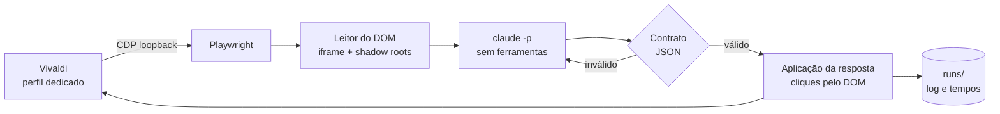

<div align="center">


**Automação de interface via Chrome DevTools Protocol: leitura estruturada do DOM, contrato de resposta validado, loop com pausa e instrumentação.**

</div>

---

> [!NOTE]
> Este é um projeto **pessoal**, validado apenas em Arch Linux com Hyprland e Vivaldi. O nome dos comandos continua
> sendo `quiz-*`, herdado do nome original do projeto (`quiz-helper`). Leia a seção
> [Uso responsável](#-uso-responsável) antes de usar.

O DRACAENA é uma ferramenta em Python que lê e responde atividades do NetAcad. Ela se conecta, por Chrome DevTools
Protocol, a um navegador já aberto, lê o estado da página como dados estruturados (atravessando o iframe da atividade e
os shadow roots abertos), entrega o enunciado ao Claude Code em modo não interativo e aplica a resposta na página,
conferindo o resultado de cada ação. A resposta volta como JSON e só chega à página depois de passar por um contrato que
valida tipo, índices, quantidade e formato. Um loop com pausa cuida das situações inesperadas, e cada etapa é
cronometrada.

A ferramenta foi desenvolvida e testada no NetAcad, o ambiente em que a página real foi observada; o conhecimento sobre
a estrutura dela está concentrado em `lib/quizhelper/dom.py` e `lib/quizhelper/browser.py`. O texto da questão vem do DOM, e
não de OCR; só as figuras que o enunciado manda consultar são capturadas do próprio elemento e enviadas como imagem.
Como os cliques saem por CDP e não movem o cursor, o computador continua utilizável enquanto o loop roda.

## ✨ Funcionalidades

| | O que faz |
|---|---|
| **Leitura pelo DOM** | Percorre o iframe `authoring-resources` e os shadow roots abertos. Reconhece `mcq-view` (resposta única e múltipla), `matching-view` / `matching-dropdown-view` (listas de seleção) e `object-matching-view` (associação). |
| **Contrato de resposta** | O Claude responde em JSON de quatro tipos: `SINGLE`, `MULTI`, `DROPDOWN` e `MATCH`. Índices fora do intervalo, quantidade errada ou resposta mal formada derivam para uma segunda tentativa, nunca para um clique. |
| **Loop com pausa** | `SUPER+P` inicia, pausa e retoma. Qualquer situação inesperada (atividade nova, figura ausente, marcação não confirmada) pausa e notifica, em vez de insistir. |
| **Segunda tentativa** | Onde a página mostra feedback de acerto, a ferramenta reconsulta o Claude com o feedback, usa Reset e responde de novo. |
| **Resposta avulsa** | `quiz-ask` responde só a questão atual, notifica e copia a resposta, sem clicar. |
| **Dry-run** | `--dry-run` lê, consulta o Claude e simula os cliques sem tocar na página. |
| **Cronometragem** | Cada questão registra o tempo de leitura do DOM, do Claude, das ações, do Submit, da espera de avanço e do restante. `python -m quizhelper timings <pasta da execução>` resume tudo (rode com o Python do venv e `PYTHONPATH=lib`). |
| **Diagnóstico** | `quiz-doctor` confere venv, Playwright, Claude, prompts, symlinks, perfil, porta, endpoint CDP, aba, iframe e a leitura de uma questão, sem clicar e sem consultar o Claude. |
| **Privacidade** | Execuções em pastas `700` e arquivos `600`, credenciais reportadas só como `definida` ou `ausente`, CDP somente em loopback. |

## 🐉 Por que o nome?


*Dracaena* é o gênero da espada de São Jorge (*Dracaena trifasciata*), planta que por muito tempo levou o nome de *Sansevieria*; a genética mostrou, em 2017, que as sansevierias são uma linhagem suculenta dentro do próprio gênero. O nome científico vem do grego *drákaina*, "dragoa", e costuma ser ligado à resina vermelha, o "sangue de dragão", que algumas espécies do gênero produzem. O nome popular brasileiro nasce da folha: longa, rígida e pontiaguda, ela sobe em lâmina, como uma espada fincada na terra.

Jorge foi um soldado romano de origem capadócia, oficial de bravura reconhecida que, por volta do ano 303, sob o imperador Diocleciano, preferiu o martírio a renegar a fé. Desde então é lembrado como mártir e como cavaleiro, padroeiro de soldados e cavaleiros e de nações como a Inglaterra. A devoção chegou ao Brasil pelas mãos de Portugal, e o seu dia é 23 de abril.

Sobre ele corre a **lenda** que a Idade Média tornou célebre, e que não pertence à história documentada: um cavaleiro de armadura reluzente, lança em punho, avança sozinho contra o dragão que aterrorizava uma cidade e não recua diante do monstro. É uma imagem de coragem, contada e recontada por séculos, e é como imagem, com respeito, que ela entra aqui.

No projeto, o dragão é a questão que parece grande demais; a lança é a ação precisa: leitura limpa da página, decisão curta, execução exata. Já o comando continua `quiz-*` por herança do `quiz-helper`: nem todo dragão merece uma refatoração completa.

---

## 📦 Instalar

Requisitos: Python 3.10+ com `venv`, Bash, `curl`, `ss`, `flock` e `setsid`, Vivaldi (`vivaldi-stable`) e o Claude Code
instalado e autenticado (`claude auth login`). São opcionais `notify-send`, `wl-copy` e o Hyprland para os atalhos.

```sh
git clone https://github.com/Pedrojscx/dracaena.git ~/src/dracaena
cd ~/src/dracaena
./install.sh --check     # só verifica as dependências
./install.sh             # venv privado, quatro symlinks e configuração inicial
```

O instalador é idempotente: não usa `sudo`, não instala pacotes do sistema, não baixa navegador, não sobrescreve a
configuração pessoal e não edita o Hyprland. Ele grava em `~/.config/quiz-helper/paths` o caminho do `claude`, porque
os atalhos do Hyprland não herdam o `PATH` do terminal. Para remover tudo: `./uninstall.sh`.

## 🎯 Uso

> [!TIP]
> Comece por `quiz-doctor` e `quiz-loop --dry-run`: nenhum dos dois clica na página (o dry-run consulta o Claude, então gasta cota).

```sh
quiz-browser        # abre o Vivaldi com perfil dedicado e CDP em 127.0.0.1:9222
                    # faça login no NetAcad e abra UMA aba /launch com a atividade
quiz-doctor         # confere o ambiente inteiro, sem clicar
quiz-loop --dry-run # lê e consulta o Claude, mas não clica
quiz-loop           # responde de verdade
```

O login e o início da atividade são manuais, no perfil dedicado. Depois disso o loop trabalha sozinho até o fim da atividade.

<details>
<summary>Exemplo ilustrativo de saída do diagnóstico</summary>

Saída de exemplo, com rótulos do `quiz-doctor`; o resultado real depende do seu ambiente.

```text
$ quiz-doctor
[OK] Python 3.10+
[OK] ambiente virtual
[OK] Playwright importável
[OK] configuração
[OK] Claude Code
[OK] autenticação Claude
[OK] navegador com perfil dedicado e porta configurada
[OK] porta CDP somente em loopback
[OK] conexão CDP
[OK] iframe da atividade acessível
[OK] leitura da questão atual (conteúdo omitido)
```

</details>

### Atalhos

Opcionais, em `config/hyprland-binds.conf` (Hyprland clássico) e `config/hyprland-binds.lua` (configuração Lua).

| Atalho | Comando | Ação |
|---|---|---|
| <kbd>SUPER</kbd> + <kbd>P</kbd> | `quiz-loop` | Inicia; se já estiver rodando, pausa ou retoma |
| <kbd>SUPER</kbd> + <kbd>SHIFT</kbd> + <kbd>P</kbd> | `quiz-ask` | Responde só a questão atual, notifica e copia a resposta, sem clicar |

### Comandos

| Comando | Comportamento |
|---|---|
| `quiz-browser [URL]` | Abre o perfil dedicado, ou uma aba no navegador CDP já disponível |
| `quiz-browser --status` | Verifica a escuta em loopback e o `/json/version` |
| `quiz-loop --status` / `--stop` | Informa se está rodando / encerra |
| `quiz-loop --once` | Processa somente uma questão |
| `quiz-loop --dry-run` | Consulta e simula as ações |
| `quiz-ask` | Consulta a questão atual e notifica a resposta |
| `quiz-doctor` | Diagnóstico somente leitura |
| `quiz-doctor env` | Compara consultas sintéticas feitas pelo terminal e pelo Hyprland (consome cota) |

## 🔀 Como funciona



Em atividades em carrossel, a questão atual vem da faixa de navegação e do contador "N of M"; em atividades de página única, do bloco indicado pelo título da aba. Figuras relevantes são capturadas do elemento da questão e enviadas ao Claude junto com o texto, e a
falta de uma figura exigida pausa o loop.

## 🔧 Configuração

O padrão fica em `config/quiz-helper.conf` e é copiado para `~/.config/quiz-helper/config` na primeira instalação.
Formato `CHAVE=VALOR`.

| Chave | Padrão | Efeito |
|---|---|---|
| `MODEL` | `haiku` | Modelo usado em `claude -p --model` |
| `RETRY_MODEL` | vazio | Modelo da segunda tentativa (vazio usa `MODEL`) |
| `CLAUDE_TIMEOUT` | `45` | Teto, em segundos, de cada chamada |
| `CDP_PORT` | `9222` | Porta do DevTools, sempre em `127.0.0.1` |
| `BROWSER_BIN` | `vivaldi-stable` | Navegador aberto pelo `quiz-browser` |
| `CLICK_SUBMIT` | `1` | `1` envia a questão atual; `0` marca e pausa |
| `SUBMIT_TIMEOUT_MS` | `5000` | Espera máxima pelo Submit existir e habilitar antes de pausar |
| `RETRY_ON_INCORRECT` | `1` | Reconsulta com o feedback onde a página o mostra |
| `KEEP_DAYS` | `7` | Idade máxima das pastas de execução |

---

## 🔒 Registros e privacidade

Cada execução gera `runs/<data>[-dryrun]/` com `run.log`, `questions.jsonl` e a saída crua do Claude por questão
(`claude/Q001.txt`). Esses arquivos podem conter enunciados, respostas e caminhos locais, ficam fora do Git e são
apagados ao iniciar um novo loop quando passam de `KEEP_DAYS`.

A porta CDP controla um perfil autenticado. Mesmo em loopback, qualquer processo local que a alcance tem esse poder, então
não a exponha nem a encaminhe. O lançador recusa escuta fora de `127.0.0.1`.

## 🩺 Solução de problemas

<details>
<summary><b>"pausado: dropdown não mostra a opção escolhida"</b></summary>

Era o defeito de ordem das opções, corrigido. Se voltar, atualize o repositório, rode `quiz-doctor` e envie o
`questions.jsonl` da execução, que traz as opções na ordem lida e o texto exibido.

</details>

<details>
<summary><b>"marcação não confirmada" depois de um <code>--dry-run</code></b></summary>

Corrigido: o dry-run não clica, então não há o que confirmar. A pausa ao fim da simulação é intencional.

</details>

<details>
<summary><b><code>[FALHA] navegador com perfil dedicado e porta configurada</code></b></summary>

Confira se o Vivaldi foi aberto pelo `quiz-browser` e não por outro atalho. O diagnóstico compara o perfil e a porta com
a linha de comando do processo principal, e um navegador aberto sem esses argumentos não passa. Um Vivaldi já aberto
antes de rodar o `quiz-browser` precisa ser fechado e reaberto por ele.

</details>

<details>
<summary><b>Autenticação do Claude ou do NetAcad expirou</b></summary>

Pause o loop, rode `claude auth login` no terminal e repita `quiz-doctor`. Para o NetAcad, entre de novo no perfil aberto
pelo `quiz-browser`, volte à atividade e retome à mão.

</details>

<details>
<summary><b>Mudanças no NetAcad</b></summary>

Componentes novos, mais de uma aba compatível, navegação durante uma ação e respostas inválidas pausam o loop. O
leitor depende da estrutura atual da página, e uma mudança de lá pode exigir ajuste aqui. A ferramenta não garante acerto.

</details>

## 🧰 Desenvolvimento

```sh
PYTHON="${XDG_DATA_HOME:-$HOME/.local/share}/quiz-helper/venv/bin/python"
"$PYTHON" -m pip install -r requirements-dev.txt
"$PYTHON" -m playwright install --only-shell chromium   # usado pelos testes de DOM
tests/run.sh
```

A suíte roda ShellCheck, compilação Python, `unittest` e `tests/check_publication.py`, que procura credenciais e arquivos
pessoais. Usa fixtures HTML sintéticas, mocks dos comandos externos e `HOME` temporário: não toca em conta real, não chama
o Claude e não usa o perfil do Vivaldi. A GitHub Action executa a mesma suíte em Python 3.10 e 3.14.

Convenções do projeto: uma branch por tarefa, um commit por item, nada de `git add -f` em perfis, cookies, `.env`,
`runs/` ou capturas reais.


## 🤝 Uso responsável

O DRACAENA automatiza a interação com uma plataforma de ensino. O seu uso, inclusive em avaliações, pode violar os termos da
Cisco Networking Academy e as regras da instituição de quem o usa, com consequências que são só dessa pessoa. A
responsabilidade pelo uso é inteiramente de quem o executa.

---

<div align="center">
<sub>DRACAENA · Pedro Lucas · 2026</sub>
</div>
