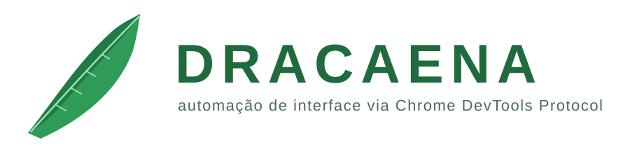
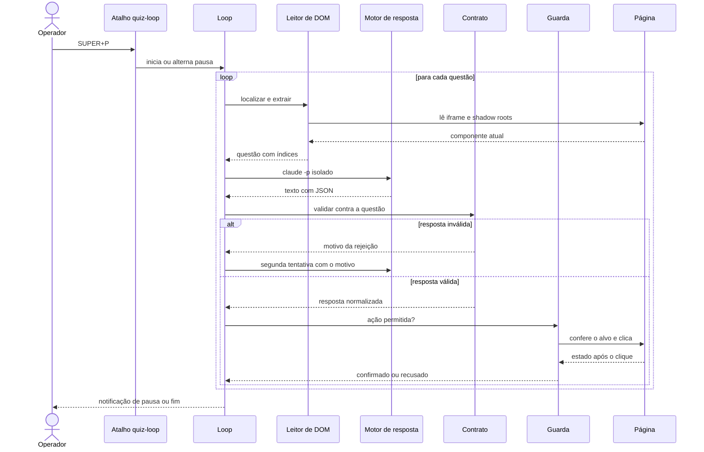
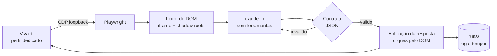

<div align="center">

<h1></h1>

**Lê a página sem ruído, decide pouco e age com exatidão.**


<a href="https://github.com/Pedrojscx/dracaena/actions/workflows/checks.yml"></a>


[Funcionalidades](#-funcionalidades) · [Por que o nome?](#-por-que-o-nome) · [Como foi feito](#-como-foi-feito) · [Arquitetura](#-arquitetura-e-decisões-técnicas) · [Desempenho](#-desempenho) · [Instalar](#-instalar) · [Uso](#-uso) · [Configuração](#-configuração) · [Problemas](#-solução-de-problemas) · [Desenvolvimento](#-desenvolvimento) · [Uso responsável](#-uso-responsável)

</div>

---

> [!NOTE]
> Este é um projeto **pessoal**, validado apenas em Arch Linux com Hyprland e Vivaldi. O nome dos comandos continua
> sendo `quiz-*`, herdado do nome original do projeto (`quiz-helper`). Leia a seção
> [Uso responsável](#-uso-responsável) antes de usar.

O DRACAENA é uma ferramenta em Python que se conecta, por Chrome DevTools Protocol, a um navegador já aberto, lê o
estado de uma página como dados estruturados (iframe e shadow roots abertos), entrega o enunciado ao Claude Code em modo
não interativo e aplica a resposta na página, conferindo o resultado de cada ação. A resposta volta como JSON e só chega à
página depois de passar por um contrato que valida índices, quantidade e formato. Um loop com pausa cuida das situações
inesperadas, e cada etapa é cronometrada. A ferramenta foi desenvolvida e testada no NetAcad, o ambiente em que a página
real foi observada: só o módulo de leitura do DOM conhece a estrutura dele.

Não há OCR, captura de tela para leitura nem automação de mouse. Como as ações saem pelo CDP e não movem o cursor, o
computador continua utilizável enquanto o loop roda.

## ✨ Funcionalidades

| | O que faz |
|---|---|
| **Leitura pelo DOM** | Percorre o iframe `authoring-resources` e os shadow roots abertos. Reconhece `mcq-view` (resposta única e múltipla), `matching-view` / `matching-dropdown-view` (listas de seleção) e `object-matching-view` (associação). |
| **Contrato de resposta** | O Claude responde em JSON de quatro tipos: `SINGLE`, `MULTI`, `DROPDOWN` e `MATCH`. Índices fora do intervalo, quantidade errada ou resposta mal formada derivam para uma segunda tentativa, nunca para um clique. |
| **Loop com pausa** | `SUPER+P` inicia, pausa e retoma. Qualquer situação inesperada (atividade nova, figura ausente, marcação não confirmada) pausa e notifica, em vez de insistir. |
| **Segunda tentativa** | Onde a página mostra feedback de acerto, a ferramenta reconsulta o Claude com o feedback, usa Reset e responde de novo. |
| **Dry-run** | `--dry-run` lê, consulta o Claude e simula os cliques sem tocar na página. |
| **Cronometragem** | Cada questão registra o tempo de leitura do DOM, do Claude, das ações, do Submit, da espera de avanço e do restante. `python -m quizhelper timings <pasta da execução>` resume tudo (rode com o Python do venv e `PYTHONPATH=lib`). |
| **Diagnóstico** | `quiz-doctor` confere venv, Playwright, Claude, prompts, symlinks, perfil, porta, endpoint CDP, aba, iframe e a leitura de uma questão, sem clicar e sem gastar cota. |
| **Privacidade** | Execuções em pastas `700` e arquivos `600`, credenciais reportadas só como `definida` ou `ausente`, CDP somente em loopback. |

## 🐉 Por que o nome?

*Dracaena* é um gênero de plantas, e o seu membro mais famoso nas casas brasileiras é a espada de São Jorge, *Dracaena trifasciata*, que até poucos anos atrás se chamava *Sansevieria trifasciata*. Estudos genéticos mostraram que as sansevierias eram uma linhagem suculenta dentro das dracenas, e a nomenclatura foi unificada. O nome científico vem do grego *drákaina*, "dragoa"; o popular, das folhas longas, eretas e pontiagudas, que lembram uma espada ou uma lança.

O santo é Jorge, soldado romano de origem na Capadócia, martirizado por volta do ano 303, na perseguição de Diocleciano, e venerado como mártir desde a Antiguidade. A parte do dragão é **lenda**, posterior ao martírio e popularizada na Idade Média: uma cidade entregava vítimas ao monstro, a princesa era a próxima, e Jorge o enfrenta com uma lança. A devoção chegou ao Brasil com os portugueses, o dia do santo é 23 de abril e, no sincretismo religioso brasileiro, ele é associado a Ogum. Aqui ele entra só como imagem, com respeito.

A imagem serve ao projeto. O dragão é a questão que parece grande demais; a lança é a ação precisa. A ferramenta lê a página sem ruído, decide pouco e age com exatidão, por uma guarda que só deixa passar o clique permitido. É só uma metáfora, mas combina.

Quanto ao comando, ele continua `quiz-*` por herança do `quiz-helper`. Renomear tudo era trabalho demais para um dragão tão pequeno.

---

## 🧪 Como foi feito

O DRACAENA foi desenvolvido por um processo assistido por agentes de IA, com papéis separados e uma única pessoa decidindo
o que entra. A separação existe por um motivo prático: quem lê logs e formula hipóteses não deve ser quem escreve o código
e quem escreve o código não deve ser quem o revisa.

| Papel | Quem | Responsabilidade |
|---|---|---|
| **Operador** | Pedro | Define o objetivo, executa a ferramenta num ambiente real, fornece logs e capturas e decide cada merge. |
| **Analista e arquiteto** | Claude (conversa) | Inventaria o repositório, lê os registros de execução, formula e descarta hipóteses e redige a especificação de cada tarefa, com escopo e critérios de aceitação. |
| **Executor** | Codex | Recebe uma especificação fechada, trabalha numa branch, faz um commit por item, roda a suíte e devolve um relatório. Não faz push. |
| **Motor de resposta** | Claude Code | Roda dentro do produto: cada consulta é uma chamada `claude -p` isolada (ver [Motor de resposta isolado](#5-motor-de-resposta-isolado)). |

O Claude Code aparece em dois lugares de propósito: fora do produto, ajudando a projetar e diagnosticar; dentro dele, como
componente restrito e sem memória entre consultas.

### Ciclo de trabalho

Cada tarefa seguiu o mesmo ciclo de cinco passos:

1. **Observação.** O operador roda a ferramenta num ambiente real e entrega o que viu: log, `questions.jsonl` e capturas.
2. **Diagnóstico.** O analista lê `run.log`, `questions.jsonl` e as saídas cruas do Claude, isola a causa e confirma no código.
3. **Especificação.** O analista escreve a tarefa com escopo, arquivos permitidos, testes exigidos e o que não pode mudar.
4. **Execução.** O executor entrega uma branch com um commit por item e um relatório do que fez e do que não conseguiu fazer.
5. **Aceitação.** O operador confere o relatório, roda a suíte, faz o merge e repete a execução real que originou a tarefa.

O critério de aceitação de cada tarefa tem duas partes: a suíte offline passa (incluindo um teste novo que reproduz o
defeito) e a situação real que o originou deixa de ocorrer. Sem as duas, a tarefa volta ao passo 2. Esse ciclo produziu,
entre outras mudanças, a remoção do motor legado de OCR, as três correções abaixo e a deduplicação dos instaladores.

### Defeitos encontrados em execução real

Os três defeitos abaixo só apareceram com a ferramenta rodando contra a página de verdade. Cada um virou teste.

<details>
<summary><b>1. Dropdown com ordem de opções diferente de <code>data-index</code></b></summary>

- **Sintoma.** O loop pausava com "dropdown não mostra a opção escolhida", embora a opção certa tivesse sido clicada.
- **Causa raiz.** Na página, os `<li role=option>` de um dropdown podem vir numa ordem do DOM diferente do atributo
  `data-index`. A extração em `lib/quizhelper/dom.py` mantinha as opções na ordem do DOM, mas o clique usa `data-index` e
  o contrato fala em índice. A conferência em `lib/quizhelper/actions.py` indexava a lista por posição (`options[o]`) e
  olhava, portanto, a opção errada.
- **Correção.** A extração ordena as opções por `data-index`, e a conferência passa a aceitar também o texto exibido no
  botão do dropdown (`shown`), que não depende de `aria-selected` estar atualizado. Commit `6621504`.
- **Teste.** `tests/py/test_dropdown.py`, com uma fixture em que a ordem do DOM é invertida: confere a ordenação, a seleção
  sem pausa e o caso em que só o texto exibido confirma a escolha.

</details>

<details>
<summary><b>2. Dry-run que acusava erro por esperar a confirmação de um clique inexistente</b></summary>

- **Sintoma.** Em `--dry-run`, a simulação terminava com a pausa "marcação não confirmada".
- **Causa raiz.** No modo de simulação a guarda não clica, mas o executor de ações ainda esperava que o DOM refletisse o
  clique, e a conferência nunca podia passar.
- **Correção.** Em `lib/quizhelper/actions.py`, a conferência é dada como satisfeita quando a guarda está em simulação.
  Commit `f4eaa2e`.
- **Teste.** `tests/py/test_dry_run.py` aplica uma resposta de cada tipo com a guarda em simulação e verifica que nenhum
  clique aconteceu, que a página ficou intacta, que nenhuma espera foi feita e que o log tem uma linha por ação simulada.

</details>

<details>
<summary><b>3. Diagnóstico que não reconhecia a flag do perfil</b></summary>

- **Sintoma.** `quiz-doctor` reportava "navegador com perfil dedicado e porta configurada" como falha, com o navegador
  aberto corretamente pelo `quiz-browser`.
- **Causa raiz.** O diagnóstico lê `/proc/<pid>/cmdline` e comparava cada argumento separado por NUL. O Vivaldi reescreve a
  linha de comando do processo principal como um texto único separado por espaços, então a comparação nunca encontrava
  as flags.
- **Correção.** `cmdline_matches`, em `lib/quizhelper/doctor.py`, aceita as duas formas, exige a flag com limites de
  argumento (para `--remote-debugging-port=92220` não casar com 9222) e ignora processos auxiliares com `--type=`.
  Commit `339bd43`. No formato de texto único, espaços em caminhos são ambíguos; o código registra essa limitação.
- **Teste.** `CmdlineMatchesTest`, em `tests/py/test_doctor.py`: argumentos separados por NUL e por espaço, porta e perfil
  diferentes, prefixo de valor, processo auxiliar e caracteres especiais no caminho.

</details>

---

## 🧱 Arquitetura e decisões técnicas

Cada subseção aponta o arquivo onde o assunto vive e explica o porquê da escolha. O princípio comum: uma falha de
interpretação, de leitura ou de rede deve terminar em pausa, nunca numa ação irreversível.



### 1. Conexão por CDP

*Arquivos: `lib/quizhelper/browser.py`, `lib/quizhelper/cdp.py`, `bin/quiz-browser`.*

O Playwright se conecta a um navegador já aberto com `connect_over_cdp`, em vez de lançar um navegador próprio. Assim a
sessão autenticada do perfil é reaproveitada, nenhum movimento de mouse é necessário e o computador fica livre durante o
loop. O navegador roda num perfil dedicado (`vivaldi-profile`, na pasta de dados), porque o Chromium 136 em diante ignora a
depuração remota no perfil padrão. A porta fica em `127.0.0.1`: o `quiz-browser` passa `--remote-debugging-address=127.0.0.1`,
confere com `ss` quem está escutando, recusa subir se a porta já escuta em outro endereço e fecha o navegador que ele abriu se a
porta escutar fora do loopback durante a subida. `cdp.py` valida o `/json/version` sem seguir redirects nem proxies e exige um WebSocket de
loopback na mesma porta.

### 2. Leitura do DOM

*Arquivo: `lib/quizhelper/dom.py`.*

A página da atividade é um iframe que usa shadow DOM aberto. O leitor injeta um pequeno conjunto de funções JavaScript que
atravessa o documento e todos os shadow roots, localiza a questão atual (pela faixa de navegação e o contador em carrossel,
ou pelo título da aba em página única) e reconhece o componente: `mcq-view`, `matching-view` com `matching-dropdown-view` e
`object-matching-view`. As opções de alternativas são ordenadas por `aria-posinset` e as de dropdown por `data-index`. Posição
na lista e índice do atributo são coisas diferentes, e misturá-las foi justamente o defeito 1 da seção anterior: o contrato,
o clique e a conferência precisam falar o mesmo índice. Ler o DOM no lugar de fazer OCR entrega texto exato e estado dos
controles (marcado, selecionado, desabilitado) sem erro de reconhecimento; nos registros locais, a leitura leva em média
alguns milissegundos por questão. O caminho de OCR foi removido do repositório (commit `131366c`).

### 3. Contrato de resposta

*Arquivos: `lib/quizhelper/contract.py`, `prompts/answer.txt`.*

O Claude responde em JSON de quatro tipos, sempre por índice, nunca por casamento aproximado de texto. Formato pedido em
`prompts/answer.txt`, com valores de exemplo:

```json
{"type":"SINGLE","answers":[2]}
{"type":"MULTI","answers":[0,3]}
{"type":"DROPDOWN","items":[{"item":0,"option":1},{"item":1,"option":0}]}
{"type":"MATCH","pairs":[{"right":0,"left":"C"},{"right":1,"left":"A"}]}
```

`parse_validated` extrai da saída o último objeto JSON que passa na validação (o modelo pode raciocinar em até três linhas
antes) e `validate` confere: tipo igual ao da questão, inteiros, índices dentro do intervalo, sem repetição, quantidade
igual à pedida, todos os itens de dropdown respondidos e todas as linhas da direita ligadas a uma letra existente.
Uma resposta rejeitada gera uma segunda consulta com o motivo (`prompts/invalid.txt`); se falhar de novo, o loop pausa.
A resposta inválida nunca chega à guarda, porque um índice errado seria um clique errado.

### 4. Guarda de cliques

*Arquivos: `lib/quizhelper/guard.py`, `lib/quizhelper/actions.py`.*

`Guard.click` é o único ponto de ação na página. Antes de cada clique, um verificador no navegador aplica, nesta ordem:
tela de envio visível, bloqueios explícitos (envio final, confirmação, `input` e `label`, Skip All, Skip Question,
navegação entre itens, a lista de palavras `SUBMIT_WORDS_BLOCKLIST`) e uma lista de permissão (alternativa, botão de
dropdown, opção de dropdown, botões de associação, e o Submit e o Reset do componente atual). Tudo fora da lista é recusado,
com o seletor registrado no log. Depois o clique só acontece se o elemento no centro do alvo for o próprio alvo ou um
descendente dele. A razão do desenho: se o modelo ou o leitor errarem, o pior caso é uma recusa, não um envio. Um teste
(`SourceTests`) falha se qualquer outro módulo chamar métodos de ação do Playwright. Em `--dry-run` a mesma guarda faz
as mesmas verificações e, em vez de clicar, registra "(dry-run) clicaria"; o `Actor` não espera confirmação nesse modo.

### 5. Motor de resposta isolado

*Arquivo: `lib/quizhelper/claude.py`.*

Cada questão é uma chamada `claude -p` independente, sem estado entre elas, executada numa pasta vazia do diretório de
execução. As flags restritivas: `--tools ""` (sem ferramentas), `--strict-mcp-config` (sem MCP), `--no-chrome` (sem
navegador), `--disable-slash-commands`, `--no-session-persistence` (nada fica salvo) e `--safe-mode` (sem `CLAUDE.md`,
plugins nem hooks), com um prompt de sistema curto em `prompts/system.txt`. O modelo não tem como agir, e a resposta de uma
questão não contamina a próxima. O `--bare` não é usado, porque nele a autenticação exigiria `ANTHROPIC_API_KEY` e o login
OAuth deixaria de valer. O comentário do módulo registra a medição da época: média de 4,5 s para 3,3 s por consulta, com a
mesma resposta.

### 6. Máquina de estados do loop

*Arquivo: `lib/quizhelper/loop.py`.*

O loop alterna entre **rodando**, **pausado** e **encerrado**. `SUPER+P` (SIGUSR1) alterna rodando e pausado; SIGTERM e
SIGINT encerram. O loop também entra em pausa e notifica, com urgência crítica, quando surge uma atividade nova (o título
da aba mudou), quando uma figura exigida pelo enunciado não pôde ser capturada, quando uma marcação não é confirmada duas
vezes, quando a guarda recusa, quando a resposta é inválida duas vezes ou quando o Claude falha. Pausas automáticas terminam
sozinhas se a questão mudar (o operador respondeu à mão); pausas do usuário só terminam com `SUPER+P`. Pausar é preferível
a insistir porque insistir, num estado que a ferramenta não entende, é como se repetem erros e envios. O encerramento acontece
sem clicar: tela de envio, tela de resultado, atividade concluída ou `MAX_QUESTIONS`. Uma questão já enviada nunca é reenviada
(`last_key`). Onde a página mostra feedback e há `RETRY_ON_INCORRECT=1`, uma resposta marcada como errada gera uma segunda
tentativa com o feedback (`prompts/retry.txt`), depois de usar o Reset do componente.

### 7. Instrumentação

*Arquivos: `lib/quizhelper/loop.py`, `lib/quizhelper/cli.py`.*

Um `Timer` mede, por questão, a leitura do DOM, o Claude, as ações, o Submit, a espera de avanço e a espera de feedback, e
soma o que está fora do Claude. O resultado vai para o campo `timing` de cada linha de `questions.jsonl`, na pasta
`runs/<data>/` do diretório de dados, e para o `run.log`. `python -m quizhelper timings <pasta da execução>` imprime uma
tabela por questão e etapa; `summary` agrega por tipo. Os números mostraram que a consulta ao modelo ocupa cerca de 92% do tempo
de cada questão, então a otimização foi feita nela (modelo leve, flags restritivas, prompt curto) e não na automação, que
soma uma fração de segundo.

### 8. Segurança e privacidade

*Arquivos: `lib/quizhelper/private.py`, `lib/quizhelper/redact.py`, `tests/check_publication.py`.*

Pastas novas nascem `700` e arquivos `600` (`private.py`, que também recusa abrir symlink em escrita). Diagnósticos mostram
credenciais só como `definida` ou `ausente` (`redact.py`), e erros do subprocesso passam pelo mesmo filtro. O CDP escuta
só em loopback.

> [!WARNING]
> A porta de depuração controla um perfil autenticado. Mesmo em loopback, qualquer processo local que a alcance tem esse poder.
> Não a exponha nem a encaminhe.

Antes de publicar, `tests/check_publication.py` procura arquivos cobertos pelo `.gitignore` que estejam rastreados ou novos
e padrões de credenciais (tokens do GitHub, chaves `sk-`/`AKIA`, chaves privadas e atribuições do tipo `password = "..."`),
sem imprimir os valores encontrados. Ele não substitui revisão humana.

### 9. Instalação idempotente

*Arquivos: `install.sh`, `lib/sh/common.sh`.*

O instalador cria um venv privado na pasta de dados, instala as dependências de `requirements.txt` nele, cria links
simbólicos em `~/.local/bin` e copia a configuração inicial. Pode ser repetido sem efeito colateral. De propósito, não usa
`sudo`, não instala pacotes do sistema nem navegador, não sobrescreve a configuração pessoal e não edita o Hyprland (apenas
imprime as linhas dos atalhos). Atalhos do Hyprland não herdam o `PATH` do terminal, então o instalador grava o caminho do
`claude` em `~/.config/quiz-helper/paths`, lido depois dos padrões do repositório e antes da configuração pessoal.

### 10. Estratégia de testes

*Arquivos: `tests/run.sh`, `tests/py/`, `tests/fixtures/`, `.github/workflows/checks.yml`.*

As páginas de teste são fixtures HTML sintéticas, geradas por `tests/fixtures/derived.py` com as tags e atributos que o leitor
espera, e um simulador (`sim.js`) reproduz marcar, Submit e avanço. Elas rodam num Chromium headless do Playwright. Os comandos
externos (`ss`, `curl`, navegador, `claude`) são simulados, e cada execução usa um `HOME` temporário. `tests/run.sh` roda o
ShellCheck, a compilação Python, o `unittest` e a verificação de publicação; a CI executa a mesma suíte em Python 3.10 e 3.14.
A suíte não cobre uma conta real, o modelo real nem mudanças futuras no site: o teste de que a ferramenta funciona contra a
página de verdade continua sendo manual, com `quiz-doctor` e `--dry-run`.

### Decisões e alternativas

| Decisão | Alternativa descartada | Motivo |
|---|---|---|
| Conectar a um navegador aberto por CDP | Lançar um navegador próprio | Reaproveita a sessão autenticada e não mexe no mouse |
| Ler o DOM | OCR sobre captura de tela | Texto e estado exatos; o OCR foi removido (`131366c`) |
| Resposta por índice, validada | Casar o texto da resposta de forma aproximada | Um índice fora do intervalo é detectável; um texto parecido não é |
| Um único ponto de ação | Cliques espalhados pelos módulos | Um teste garante que só `guard.py` age na página |
| Clique feito no DOM, no elemento sob o alvo | Eventos de mouse do Playwright | Não depende de a aba estar sendo desenhada nem do cursor |
| Uma chamada `claude -p` por questão, sem ferramentas | Sessão persistente do Claude Code com ferramentas | Sem estado entre questões e menor latência medida |
| Pausar diante do inesperado | Repetir a ação até dar certo | Evita cliques repetidos ou fora de lugar |

## 🚀 Desempenho

Medido nos registros locais de `questions.jsonl` (execuções reais com o modelo `haiku`). Esses registros ficam fora do
Git, então os valores abaixo, arredondados, não podem ser reproduzidos a partir do repositório.

| Métrica | Valor |
|---|---|
| Tempo médio por questão | cerca de 4,4 s |
| Parcela desse tempo na consulta ao modelo | cerca de 92% |

Ler o DOM, agir e esperar o avanço somam menos de meio segundo por questão. Qualquer ganho de velocidade está na escolha
do modelo (`MODEL` e `RETRY_MODEL` na configuração) e no tamanho do prompt, não na automação.

---

## 📦 Instalar

Requisitos: Python 3.10+ com `venv`, Bash, `curl`, `ss`, `flock` e `setsid`, Vivaldi (`vivaldi-stable`) e o Claude Code
instalado e autenticado (`claude auth login`). São opcionais `notify-send`, `wl-copy` e o Hyprland para os atalhos.

```sh
git clone https://github.com/Pedrojscx/dracaena.git ~/src/dracaena
cd ~/src/dracaena
./install.sh --check     # só verifica as dependências
./install.sh             # venv privado, quatro symlinks e configuração inicial
```

O instalador é idempotente: não usa `sudo`, não instala pacotes do sistema, não baixa navegador, não sobrescreve a
configuração pessoal e não edita o Hyprland. Ele grava em `~/.config/quiz-helper/paths` o caminho do `claude`, porque
os atalhos do Hyprland não herdam o `PATH` do terminal. Para remover tudo: `./uninstall.sh`.

## 🎯 Uso

> [!TIP]
> Comece por `quiz-doctor` e `quiz-loop --dry-run`: nenhum dos dois clica na página.

```sh
quiz-browser        # abre o Vivaldi com perfil dedicado e CDP em 127.0.0.1:9222
                    # faça login no NetAcad e abra UMA aba /launch com a atividade
quiz-doctor         # confere o ambiente inteiro, sem clicar
quiz-loop --dry-run # lê e consulta o Claude, mas não clica
quiz-loop           # responde de verdade
```

O login e o início da atividade são manuais, no perfil dedicado. Depois disso o loop trabalha sozinho até o fim da atividade.

<details>
<summary>Exemplo ilustrativo de saída do diagnóstico</summary>

Saída de exemplo, com rótulos do `quiz-doctor`; o resultado real depende do seu ambiente.

```text
$ quiz-doctor
[OK] Python 3.10+
[OK] ambiente virtual
[OK] Playwright importável
[OK] configuração
[OK] Claude Code
[OK] autenticação Claude
[OK] navegador com perfil dedicado e porta configurada
[OK] porta CDP somente em loopback
[OK] conexão CDP
[OK] iframe da atividade acessível
[OK] leitura da questão atual (conteúdo omitido)
```

</details>

### Atalhos

Opcionais, em `config/hyprland-binds.conf` (Hyprland clássico) e `config/hyprland-binds.lua` (configuração Lua).

| Atalho | Comando | Ação |
|---|---|---|
| <kbd>SUPER</kbd> + <kbd>P</kbd> | `quiz-loop` | Inicia; se já estiver rodando, pausa ou retoma |
| <kbd>SUPER</kbd> + <kbd>SHIFT</kbd> + <kbd>P</kbd> | `quiz-ask` | Responde só a questão atual, notifica e copia a resposta, sem clicar |

### Comandos

| Comando | Comportamento |
|---|---|
| `quiz-browser [URL]` | Abre o perfil dedicado, ou uma aba no navegador CDP já disponível |
| `quiz-browser --status` | Verifica a escuta em loopback e o `/json/version` |
| `quiz-loop --status` / `--stop` | Informa se está rodando / encerra |
| `quiz-loop --once` | Processa somente uma questão |
| `quiz-loop --dry-run` | Consulta e simula as ações |
| `quiz-ask` | Consulta a questão atual e notifica a resposta |
| `quiz-doctor` | Diagnóstico somente leitura |
| `quiz-doctor env` | Compara consultas sintéticas feitas pelo terminal e pelo Hyprland (consome cota) |

## 🔀 Como funciona



Em atividades em carrossel, a questão atual vem da faixa de navegação e do contador "N of M"; em atividades de página única, do bloco indicado pelo título da aba. Figuras relevantes são capturadas do elemento da questão e enviadas ao Claude junto com o texto, e a
falta de uma figura exigida pausa o loop.

## 🔧 Configuração

O padrão fica em `config/quiz-helper.conf` e é copiado para `~/.config/quiz-helper/config` na primeira instalação.
Formato `CHAVE=VALOR`.

| Chave | Padrão | Efeito |
|---|---|---|
| `MODEL` | `haiku` | Modelo usado em `claude -p --model` |
| `RETRY_MODEL` | vazio | Modelo da segunda tentativa (vazio usa `MODEL`) |
| `CLAUDE_TIMEOUT` | `45` | Teto, em segundos, de cada chamada |
| `CDP_PORT` | `9222` | Porta do DevTools, sempre em `127.0.0.1` |
| `BROWSER_BIN` | `vivaldi-stable` | Navegador aberto pelo `quiz-browser` |
| `CLICK_SUBMIT` | `1` | `1` envia a questão atual; `0` marca e pausa |
| `RETRY_ON_INCORRECT` | `1` | Reconsulta com o feedback onde a página o mostra |
| `KEEP_DAYS` | `7` | Idade máxima das pastas de execução |


---

## 🔒 Registros e privacidade

Cada execução gera `runs/<data>[-dryrun]/` com `run.log`, `questions.jsonl` e a saída crua do Claude por questão
(`claude/Q001.txt`). Esses arquivos podem conter enunciados, respostas e caminhos locais, ficam fora do Git e são
apagados ao iniciar um novo loop quando passam de `KEEP_DAYS`.

A porta CDP controla um perfil autenticado. Mesmo em loopback, qualquer processo local que a alcance tem esse poder, então
não a exponha nem a encaminhe. O lançador recusa escuta fora de `127.0.0.1`.

## 🩺 Solução de problemas

<details>
<summary><b>"pausado: dropdown não mostra a opção escolhida"</b></summary>

Era o defeito de ordem das opções, corrigido. Se voltar, atualize o repositório, rode `quiz-doctor` e envie o
`questions.jsonl` da execução, que traz as opções na ordem lida e o texto exibido.

</details>

<details>
<summary><b>"marcação não confirmada" depois de um <code>--dry-run</code></b></summary>

Corrigido: o dry-run não clica, então não há o que confirmar. A pausa ao fim da simulação é intencional.

</details>

<details>
<summary><b><code>[FALHA] navegador com perfil dedicado e porta configurada</code></b></summary>

Confira se o Vivaldi foi aberto pelo `quiz-browser` e não por outro atalho. O diagnóstico compara o perfil e a porta com
a linha de comando do processo principal, e um navegador aberto sem esses argumentos não passa. Um Vivaldi já aberto
antes de rodar o `quiz-browser` precisa ser fechado e reaberto por ele.

</details>

<details>
<summary><b>Autenticação do Claude ou do NetAcad expirou</b></summary>

Pause o loop, rode `claude auth login` no terminal e repita `quiz-doctor`. Para o NetAcad, entre de novo no perfil aberto
pelo `quiz-browser`, volte à atividade e retome à mão.

</details>

<details>
<summary><b>Mudanças no NetAcad</b></summary>

Componentes novos, mais de uma aba compatível, navegação durante uma ação e respostas inválidas pausam o loop. O
leitor depende da estrutura atual da página, e uma mudança de lá pode exigir ajuste aqui. A ferramenta não garante acerto.

</details>

## 🧰 Desenvolvimento

```sh
PYTHON="${XDG_DATA_HOME:-$HOME/.local/share}/quiz-helper/venv/bin/python"
"$PYTHON" -m pip install -r requirements-dev.txt
"$PYTHON" -m playwright install --only-shell chromium   # só para os testes de DOM
tests/run.sh
```

A suíte roda ShellCheck, compilação Python, `unittest` e `tests/check_publication.py`, que procura credenciais e arquivos
pessoais. Usa fixtures HTML sintéticas, mocks dos comandos externos e `HOME` temporário: não toca em conta real, não chama
o Claude e não usa o perfil do Vivaldi. A GitHub Action executa a mesma suíte em Python 3.10 e 3.14.

Convenções do projeto: uma branch por tarefa, um commit por item, nada de `git add -f` em perfis, cookies, `.env`,
`runs/` ou capturas reais.

## 🤝 Uso responsável

O DRACAENA automatiza a interação com uma plataforma de ensino. Usá-lo em avaliações pode violar os termos de uso da
plataforma e as regras da sua instituição, com consequências acadêmicas que são só de quem o usa. A ferramenta bloqueia o
envio final por segurança, mas isso não a torna adequada para esse fim. Use-a em atividades de estudo e em contas e cursos
onde você tem autorização para isso.

O projeto ainda não tem licença definida, então por padrão todos os direitos são reservados.

---

<div align="center">
<sub>DRACAENA · Pedro Lucas · 2026</sub>
</div>
